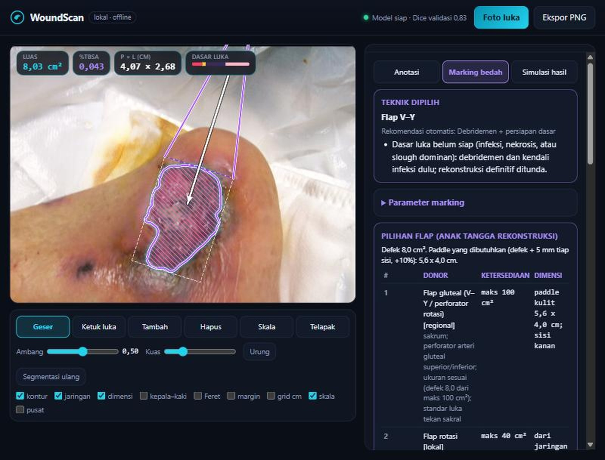
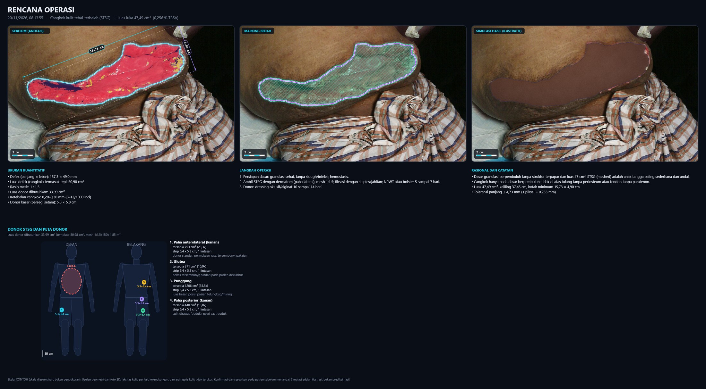
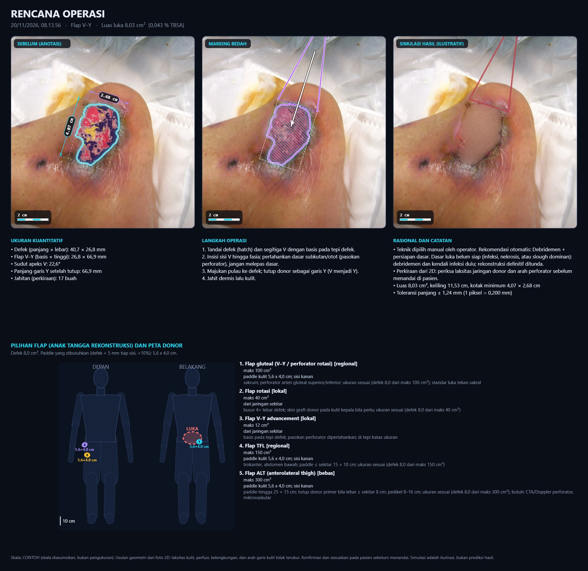
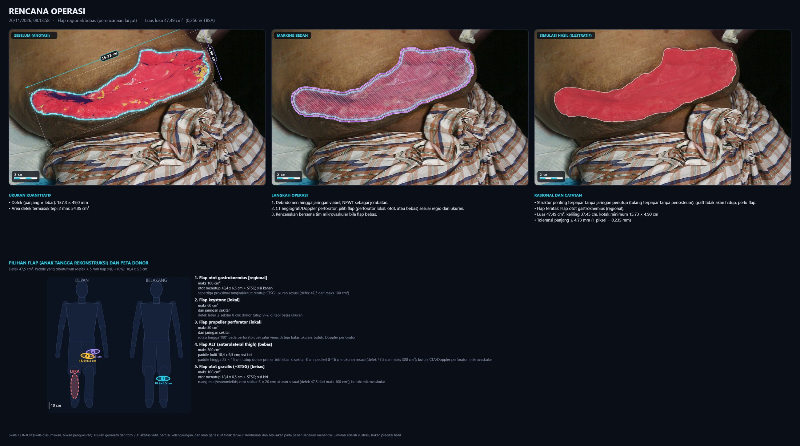
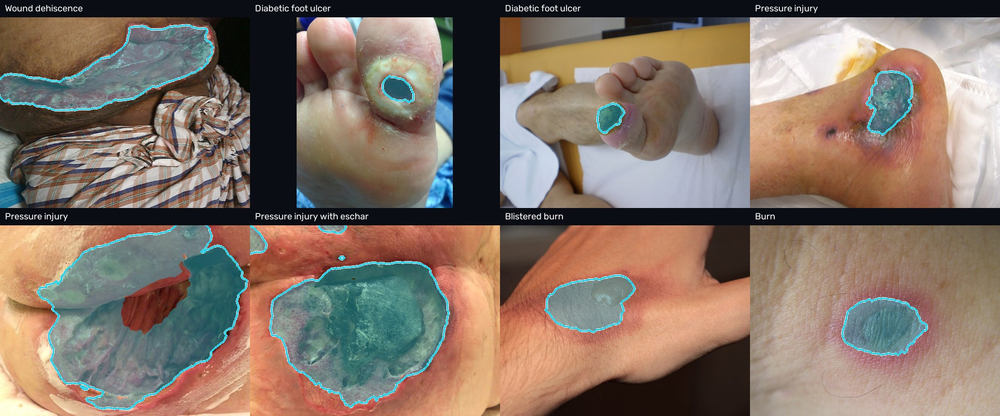

<p align="center">
  
</p>

<p align="center">
  
  
  
  
</p>

# WoundScan

<p align="center"><em>A bioinformatics and deep learning framework for calibrated wound segmentation, quantitative measurement, and reconstructive surgical planning in emergency and outpatient care</em></p>

<p align="center">Muhammad Allam Rafi<sup>1</sup>, Cindy Rizky Afrilia<sup>2</sup><br><sup>1</sup>Faculty of Medicine, Universitas Indonesia, Jakarta, Indonesia<br><sup>2</sup>Faculty of Medicine, Universitas Kristen Krida Wacana, Jakarta, Indonesia</p>

<p align="center">OSF DOI 10.17605/OSF.IO/XXXXX<br>Zenodo DOI 10.5281/zenodo.XXXXXXX</p>

## Abstract

Introduction. Wounds are still assessed mostly by eye, and manual area estimates differ between observers. Emergency departments and outpatient clinics rarely have a tool that turns a single photograph into a calibrated measurement and an operative plan. We describe WoundScan, an open research tool that combines deep learning segmentation, camera geometry, and rule based reconstructive planning.

Methods. A U-Net with a MobileNetV2 encoder was trained on 810 expert annotated foot ulcer images and, in a second round, on 800 further images from the WoundSeg collection whose coarse masks were sharpened with seeded GrabCut and colour based edge peeling. Pixel size comes from a reference object, the patient's palm, or camera distance. Area, perimeter, and percent total body surface area then follow from the Mosteller body surface area. A planning module proposes fusiform excision, linear closure, advancement and V to Y flaps, Z plasty, and skin grafts, and ranks donor sites with Lund and Browder regional fractions.

Results and Discussion. On 200 validation images the model reached a Dice coefficient of 0.827 with a median area error of 11.5 percent, and on 160 external Medetec images it reached 0.793. The geometry routines reproduced analytic areas within 0.07 percent. In 31 public photographs the model segmented dehiscence, diabetic ulcers, large pressure injuries, and blistered burns reliably, but it missed small punctures and thin abrasions. Region cropping and promptable segmentation did not improve accuracy. Absolute size depends on calibration, which adds a length error between two and ten percent.

Conclusion. Calibrated single photograph measurement and structured reconstructive planning are feasible in a browser without any server upload. Prospective clinical validation is required before use in patient care.

Keywords. Wound segmentation, Medical image analysis, Reconstructive surgery, Deep learning

<p align="center">
  
</p>
<p align="center"><sub><em>Figure 1. Browser interface in marking view for a sacral pressure injury. The left panel shows the calibrated segmentation, the dimensions, and the V to Y flap marking, and the right panel lists the ranked flap options with their size limits.</em></sub></p>

## Methods

The application is a static website. All computation happens in the browser through onnxruntime-web, so photographs of patients never leave the device. The segmentation network is a U-Net whose encoder is a MobileNetV2 pretrained on ImageNet. It receives a 256 by 256 image, carries a full resolution skip connection from the input to sharpen boundaries, and is exported to ONNX at about ten megabytes. At inference the probability map is averaged over the original image and its horizontal and vertical flips, then resampled to the working resolution of the photograph, which is capped at 1400 pixels on the long side.

Training used two data sources. The Foot Ulcer Segmentation Challenge collection supplied 810 training and 200 validation images with careful expert masks. The WoundSeg collection supplied 2686 images across eight wound types, but visual inspection showed that many masks were blocky and some covered peri wound skin. We therefore refined them with GrabCut, using the eroded coarse mask and confident model pixels as foreground seeds, and then removed edge pixels whose CIELAB colour matched the surrounding skin. This kept 1987 images. The first round trained on the foot ulcer images for 16 epochs. The second round continued for 7 epochs on the foot ulcer images, counted twice, together with 800 refined WoundSeg images. Optimisation used AdamW with a one cycle schedule and a loss that summed binary cross entropy and Dice loss. All training ran on a CPU.

A photograph carries no absolute scale, so the program does not report centimetres until the user supplies one. The user may mark two points on an object of known length, outline the patient's palm, which is taken as 0.8 percent of body surface area, or enter the camera distance and the 35 mm equivalent focal length. The expected length error is about two percent for a reference object, eight percent for camera distance, and ten percent for the palm, and the area error is roughly twice these values. Boundary uncertainty is estimated by sweeping the probability threshold and is combined with the calibration error in quadrature. Percent total body surface area equals the wound area divided by the Mosteller body surface area. A rough estimate of tissue composition is obtained from CIELAB colour relative to the peri wound skin, and it is meant as a screening aid and not as a histological result.

The planning module works from the calibrated mask. For closure it solves, by bisection, the smallest fusiform ellipse with a chosen length to width ratio and a 30 degree apex angle that contains the whole defect, and it places an odd number of interrupted sutures with equal spacing and numbers them in the order of the rule of halves. Flaps, Z plasty with the usual theoretical gains of 25, 50, 75, 100, and 120 percent for angles of 30, 45, 60, 75, and 90 degrees, and skin graft templates are drawn as geometric markings. A reconstructive decision step then chooses between primary closure, graft, and flap from the state of the wound bed, exposed structures, osteomyelitis, prior irradiation, anatomical region, and size. For grafts it compares the donor area needed with the area available, which is estimated from the body surface area, Lund and Browder regional fractions, and a usable fraction for each donor. For flaps it ranks 22 local, regional, and free candidates by region, defect size, and patient factors such as diabetes, peripheral arterial disease, and smoking. The donor map draws a front and back mannequin at the patient's height with Drillis and Contini segment proportions, the wound, and the numbered donor sites with their dimensions. A simulated postoperative image is produced by filling the planned region from surrounding skin and drawing the closure line, and it is only an illustration.

<p align="center">
  
</p>
<p align="center"><sub><em>Figure 2. Planning sheet for a large dehiscence wound closed with a split thickness skin graft. The sheet combines the annotated photograph, the graft template with mesh pattern, a simulated result, the quantitative table, and the ranked donor sites on a mannequin drawn to the height of the patient. The scale is assumed for illustration.</em></sub></p>

<p align="center">
  
</p>
<p align="center"><sub><em>Figure 3. Planning sheet for a V to Y advancement flap on a sacral pressure injury, showing the flap base, the incision lines, the direction of advancement, and the estimated number of sutures.</em></sub></p>

<p align="center">
  
</p>
<p align="center"><sub><em>Figure 4. Planning sheet for a wide leg defect with exposed bone. The decision step selects a flap, the ranked list places a gastrocnemius muscle flap first for the proximal third of the leg, and a free anterolateral thigh flap from the opposite side appears among the later options.</em></sub></p>

## Validation and limitations

On the 200 foot ulcer validation images the final model reached a Dice coefficient of 0.827 and an intersection over union of 0.744, with a median relative area error of 11.5 percent. The first round alone gave 0.803. Because these images also chose the best epoch, the figures are somewhat optimistic. On 160 Medetec images that the model had never seen, the Dice coefficient was 0.793 and the median area error was 23.9 percent. The geometry code was checked against shapes with known formulas. Areas agreed within 0.07 percent, perimeters of smooth shapes within 0.2 percent, and the perimeter of a rectangle with sharp corners within 0.93 percent. An automated stress test built 484 surgical plans, 30 planning sheets, and 146 random clinical combinations without a failure.

We also tested three ideas that seemed likely to help and did not. Running the network again on a crop around the first detection lowered the Dice coefficient from 0.859 to 0.794 on 95 validation images. Refining the mask with MobileSAM and a box prompt was accepted by our consistency rule for only 4 of the 95 images and did not improve the score. Averaging predictions at 256, 320, and 384 pixels changed the Dice coefficient from 0.8606 to 0.8616, which does not justify the extra computation, and an input of 512 pixels failed at 0.668 because it lies far from the training scale.

A qualitative test used 31 photographs from Wikimedia Commons that cover burns, bites, abrasions, lacerations, ulcers, pressure injuries, and dehiscence. Segmentation was reliable for dehiscence, diabetic foot ulcers, large pressure injuries including black eschar, linear lacerations, and blistered burns. It failed for small puncture wounds, thin diffuse abrasions, and an ulcerating carcinoma, and it produced false positives on photographs that contained no wound. The training data are dominated by chronic wounds, and there is no public collection with burn depth labels, so acute wounds and burns remain the weakest area. A brush and a tap tool allow the user to correct the mask.

<p align="center">
  
</p>
<p align="center"><sub><em>Figure 5. Automatic segmentation on public photographs that were not used for training. The cyan outline marks the predicted wound area.</em></sub></p>

The clinical content, which covers dosing, thresholds, closure limits, flap size ranges, and donor dimensions, was written from general surgical and wound care literature and has not been checked line by line against the source guidelines. Skin laxity, perforator anatomy, vascular status, and the direction of relaxed skin tension lines cannot be measured from a two dimensional photograph, so every marking is a proposal that the surgeon must confirm on the patient. Malignancy cannot be decided from a photograph, and the program only raises suspicion and suggests biopsy. WoundScan is a research prototype and not a medical device.

## Software and reproducibility

The static site lives in the app folder. To run it locally, start the bundled server and open the address in a browser. The server sends no cache headers, which keeps the development copy current.

```bash
python serve.py
```

On Windows the file jalankan.bat does the same. To publish the site, import the repository in Vercel with the framework preset set to Other and an empty build command, because vercel.json already points to the app folder. Training and evaluation scripts are in the train folder and need the public datasets placed in a data folder. The three stages run in sequence.

```bash
python train/train.py round1 16
python train/train.py refine
python train/train.py round2 7
```

Persistent identifiers for the protocol and the archived release will be added at the top of this page once the OSF project and the Zenodo record are created.

## Data and licensing

The released weights were trained on WoundSeg, which is licensed CC BY NC 4.0, and on the Foot Ulcer Segmentation Challenge images, which carry no written licence. The weights should therefore be treated as research and non commercial material, and clinical or commercial use needs permission from the dataset owners or retraining on local data. The burn dataset EBIS is available only on academic request and is not included. Wikimedia Commons photographs used for the qualitative test are not redistributed, and their sources are listed in webtest/sources.tsv. Photographs shown in the figures come from Wikimedia Commons and are credited in docs/figures/CREDITS.md. The repository contains no patient data. A software licence has not yet been attached.

## Citation

```bibtex
@software{rafi_woundscan,
  author  = {Rafi, Muhammad Allam and Afrilia, Cindy Rizky},
  title   = {WoundScan, a bioinformatics and deep learning framework for calibrated wound segmentation and reconstructive surgical planning},
  year    = {2026},
  doi     = {10.5281/zenodo.XXXXXXX},
  note    = {OSF 10.17605/OSF.IO/XXXXX}
}
```

## References

Wang C, Anisuzzaman DM, Williamson V, Dhar MK, Rostami B, Niezgoda J, Gopalakrishnan S, Yu Z. Fully automatic wound segmentation with deep convolutional neural networks. Scientific Reports. 2020. 10, 21897. doi 10.1038/s41598-020-78799-w

Oota SR, Rowtula V, Mohammed S, Liu M, Gupta M. WSNet, towards an effective method for wound image segmentation. IEEE/CVF Winter Conference on Applications of Computer Vision. 2023. 3234 to 3243.

Curti N, Merli Y, Zengarini C, Giampieri E, Merlotti A, Dall'Olio D, Marcelli E, Bianchi T, Castellani G. Effectiveness of semi supervised active learning in automated wound image segmentation. International Journal of Molecular Sciences. 2023. 24, 706.

Ronneberger O, Fischer P, Brox T. U-Net, convolutional networks for biomedical image segmentation. Medical Image Computing and Computer Assisted Intervention. 2015.

Sandler M, Howard A, Zhu M, Zhmoginov A, Chen LC. MobileNetV2, inverted residuals and linear bottlenecks. IEEE Conference on Computer Vision and Pattern Recognition. 2018.

Rother C, Kolmogorov V, Blake A. GrabCut, interactive foreground extraction using iterated graph cuts. ACM Transactions on Graphics. 2004. 23, 309 to 314.

Mosteller RD. Simplified calculation of body surface area. New England Journal of Medicine. 1987. 317, 1098.

Lund CC, Browder NC. The estimation of areas of burns. Surgery, Gynecology and Obstetrics. 1944. 79, 352 to 358.

Drillis R, Contini R. Body segment parameters. Office of Vocational Rehabilitation, New York University. 1966.

Janis JE, Kwon RK, Attinger CE. The new reconstructive ladder, modifications to the traditional model. Plastic and Reconstructive Surgery. 2011. 127.
