# MOTION-CATALOG-2: paket efek yang bisa dipakai ulang

Paket lengkap untuk memindahkan gerakan, efek, dan gambar acuan WoundScan ke proyek lain (misalnya FaceStudio). Setiap efek punya: **gambar hasil**, **apa fungsinya**, **parameter yang boleh disetel**, dan **kode lengkap yang disalin langsung dari sumber** (bukan ditulis ulang), jadi bisa ditempel dan jalan.

Gambar ada di `docs/motion-catalog/img/` (23 berkas, 1,4 MB). Katalog peta dan keputusan desain ada di `MOTION-CATALOG-1.md`. Dasar: commit `b66f9f8`, tanggal 2026-11-23.

## 0. Cara memakai di proyek lain

1. Dependensi (versi yang dipakai di WoundScan): `three@^0.187`, `gsap@^3.15` (ScrollTrigger, SplitText), `lenis@^1.3`, `postprocessing`, `vite` + TypeScript.
2. Salin berkas sesuai bagian yang diinginkan. Tiap bagian menyebut berkas sumbernya di `web/src/...`.
3. Warna dan huruf dipasang sebagai token `:root` (bagian 1); ganti nilainya untuk proyek baru.
4. Aturan wajib saat memakai ulang: matikan efek untuk `prefers-reduced-motion`, matikan efek pointer di layar sentuh, jangan menambah semua efek sekaligus (satu dunia, beberapa sentuhan halus).

## Daftar gambar

| Bagian | Gambar |
|---|---|
| Laman awal | `landing-hero`, `landing-layers-ghost-01`, `landing-measure-hud-ghost-03`, `landing-body` |
| Workbench 2D | `wb-annotation-dims-tissue`, `wb-marking-debridement`, `wb-marking-stsg`, `wb-marking-advancement-flap`, `wb-outline-edit-result` |
| 3D permukaan | `v3-surface-flap-lift`, `v3-surface-flap-inset-sutures`, `v3-surface-graft-flight`, `v3-surface-graft-landed-staples`, `v3-surface-npwt-foam-film-tube`, `v3-surface-final-landscape` |
| 3D potongan lapisan | `v3-cut-lesion-lifted`, `v3-cut-deep-suture`, `v3-cut-three-layer-sutures`, `v3-cut-flap-elevation`, `v3-cut-flap-three-layer`, `v3-cut-graft-harvest-meshing`, `v3-cut-graft-bolster-film`, `v3-cut-biopsy-punch` |

## 1. Warna, huruf, dan token

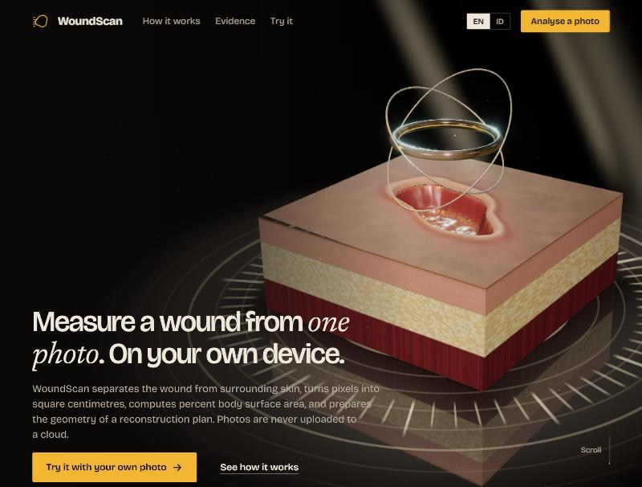
*Hero: blok kulit berlapis, kawah luka, cincin platinum, sinar cahaya, lantai memantul, lantai berskala*

Palet: malam `#0d0b0a`, kertas tulang `#f5f1e8`, tinta `#15110e`, kuning pita ukur `#f2b632`, tinta penanda biru `#2c3fa8`. Huruf: Bricolage Grotesque Variable (tampilan), Newsreader serif miring untuk penekanan, IBM Plex Mono untuk data. Berkas: `styles/base.css`.

```css
:root {
  /* palette: operating-theatre night, bone paper, surgical marking ink, measuring-tape yellow */
  --night: #0d0b0a;
  --night-2: #1a1512;
  --bone: #ece6da;
  --paper: #f5f1e8;
  --ink: #15110e;
  --ink-2: #51463d;
  --rule: #cfc6b6;
  --on-night: #efe8da;
  --on-night-2: #b8ad9f;
  --tape: #f2b632;
  --tape-deep: #d99a14;
  --marker: #2c3fa8;
  --blood: #8e1f26;
  --ok: #2f6b45;

  --font: 'Bricolage Grotesque Variable', 'Bricolage Grotesque', ui-sans-serif, system-ui, sans-serif;
  --serif: 'Newsreader', 'Iowan Old Style', Georgia, serif;
  --mono: 'IBM Plex Mono', ui-monospace, SFMono-Regular, Menlo, monospace;
  /* ...spacing tokens... */
}
```

## 2. Mesin dunia scroll (satu scene yang menetap)

Dunia adalah **fungsi murni dari posisi scroll**: `evaluate(chapters, scrollY, vh)` mengembalikan keadaan kamera, cahaya, dan objek. Scroll mundur memutar balik semuanya. Setiap bab punya satu `Key`; antar bab dicampur dengan easing plateau (`(u - 0.2) / 0.6`, jadi 20 persen awal dan akhir menahan). Kamera melengkung selama penerbangan (`sin(pi * f) * 1.4`).

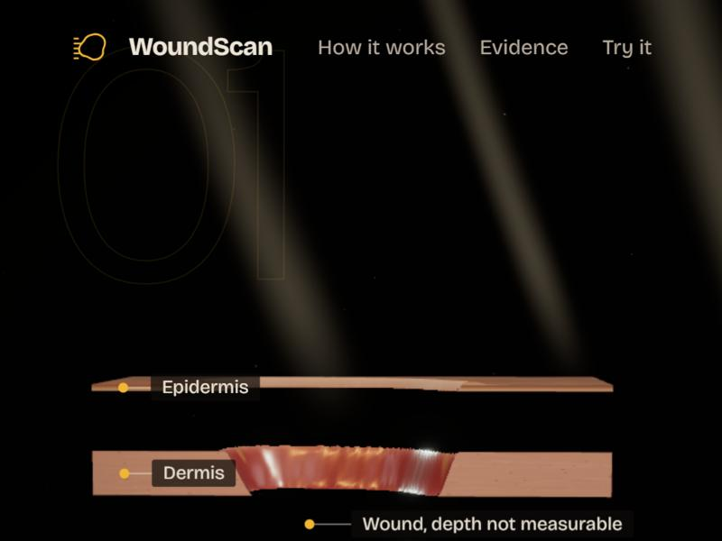
*Bab 1: lapisan terurai (explode 1,15), label dengan garis penunjuk, angka hantu 01*


*Bab 3: ukuran dari bentuk 3D, HUD `03 -- MEASURE`, angka hantu 03*

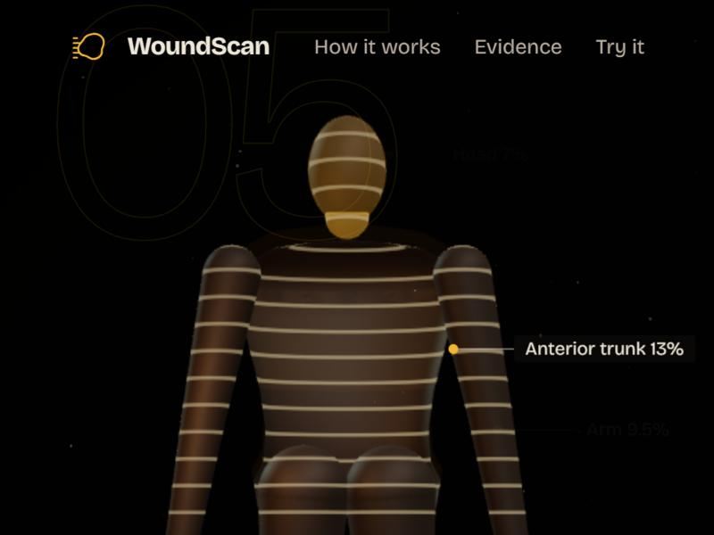
*Bab 5: manekin dan peta luas tubuh*

**Berkas `world/choreography.ts` (lengkap):**

```ts
import { clamp, easeInOut, smoothstep, lerp } from './noise';

export interface Key {
  cam: [number, number, number];
  tgt: [number, number, number];
  fov: number;
  shiftX: number; // fraction of width the subject is pushed to the right
  cut: number;
  outline: number;
  doubt: number;
  iso: number;
  mask: number;
  ruler: number;
  block: number;
  tile: number;
  body: number;
  lens: number;
  lensX: number;
  lensY: number;
  pulse: number;
  pulseR: number;
  explode: number;
  beam: number;
  span: number; // width of the subject as a fraction of the screen at aspect 1.78
}

/* One key per chapter, in DOM order: hero, layers, scan, measure, plan, body, private. */
export const KEYS: Key[] = [
  { cam: [13.5, 8.2, 17.2], tgt: [0, -1.6, 0], fov: 30, shiftX: 0.27, cut: 5, outline: 0, doubt: 0, iso: 0, mask: 0, ruler: 0, block: 1, tile: 0, body: 0, lens: 1, lensX: 0, lensY: 2.6, pulse: 0, pulseR: 8, explode: 0, beam: 1.0, span: 0.6 },
  { cam: [1.2, -0.2, 25.5], tgt: [0, -3.0, 0], fov: 30, shiftX: -0.2, cut: 0.15, outline: 0, doubt: 0, iso: 0, mask: 0, ruler: 0, block: 1, tile: 0, body: 0, lens: 0, lensX: -5, lensY: 3.4, pulse: 0, pulseR: 8, explode: 1.15, beam: 0.55, span: 0.5 },
  { cam: [10.5, 17.8, 14.6], tgt: [0, -0.7, 0], fov: 28, shiftX: 0.22, cut: 5, outline: 1, doubt: 0.85, iso: 1, mask: 0.5, ruler: 0, block: 1, tile: 0, body: 0, lens: 1, lensX: 0, lensY: 1.5, pulse: 0, pulseR: 8, explode: 0, beam: 0.25, span: 0.55 },
  { cam: [-7.8, 20.0, 13.8], tgt: [0, -0.2, 0.6], fov: 27, shiftX: -0.24, cut: 5, outline: 1, doubt: 0.35, iso: 1, mask: 0.28, ruler: 1, block: 1, tile: 0, body: 0, lens: 0, lensX: 5, lensY: 3, pulse: 0, pulseR: 8, explode: 0, beam: 0.0, span: 0.56 },
  { cam: [3.0, 18.5, 9.5], tgt: [0, 0, 0.2], fov: 28, shiftX: 0.2, cut: 5, outline: 0, doubt: 0, iso: 0, mask: 0, ruler: 0, block: 0, tile: 1, body: 0, lens: 0, lensX: 0, lensY: 3.2, pulse: 0, pulseR: 8, explode: 0, beam: 0.0, span: 0.5 },
  { cam: [0, 1.6, 31], tgt: [0, 1.6, 0], fov: 28, shiftX: -0.22, cut: 5, outline: 0, doubt: 0, iso: 0, mask: 0, ruler: 0, block: 0, tile: 0, body: 1, lens: 0, lensX: 0, lensY: 3, pulse: 0, pulseR: 8, explode: 0, beam: 0.0, span: 0.3 },
  { cam: [0.1, 25, 12], tgt: [0, -3.4, 0], fov: 32, shiftX: 0.2, cut: 5, outline: 0.55, doubt: 0, iso: 0.4, mask: 0, ruler: 0, block: 1, tile: 0, body: 0, lens: 1, lensX: 0, lensY: 1.8, pulse: 1, pulseR: 4.5, explode: 0, beam: 0.45, span: 0.5 },
];

export interface Chapter {
  top: number;
  height: number;
}

export interface State {
  key: Key;
  scanX: number;
  scanProg: number;
  scanOn: number;
  zp: number;
  bp: number;
  rulerP: number;
  localT: number[];
  index: number; // continuous chapter index, e.g. 2.4
}

const lerpKey = (a: Key, b: Key, f: number): Key => {
  const o = {} as Record<string, unknown>;
  (Object.keys(a) as (keyof Key)[]).forEach((k) => {
    const va = a[k];
    const vb = b[k];
    o[k] = Array.isArray(va) ? (va as number[]).map((x, i) => lerp(x, (vb as number[])[i], f)) : lerp(va as number, vb as number, f);
  });
  return o as unknown as Key;
};

/* s: scrollY, vh: viewport height. Pure function of scroll, so the world is fully reversible. */
export function evaluate(chapters: Chapter[], s: number, vh: number): State {
  const n = chapters.length;
  const mid = s + vh * 0.5;
  const centers = chapters.map((c) => c.top + c.height * 0.5);
  const localT = chapters.map((c) => clamp((mid - c.top) / c.height));
  let i = 0;
  while (i < n - 2 && mid > centers[i + 1]) i++;
  const span = centers[i + 1] - centers[i];
  const u = clamp((mid - centers[i]) / span, 0, 1);
  const f = easeInOut(clamp((u - 0.2) / 0.6));
  const key = lerpKey(KEYS[Math.min(i, KEYS.length - 1)], KEYS[Math.min(i + 1, KEYS.length - 1)], f);
  // arc the camera a little during a flight, so it travels instead of sliding
  key.cam[1] += Math.sin(Math.PI * f) * 1.4;

  const scanT = clamp((localT[2] - 0.12) / 0.7);
  const scanProg = mid < centers[2] - chapters[2].height * 0.5 ? 0 : mid > chapters[2].top + chapters[2].height ? 1 : scanT;
  const scanX = lerp(-6.4, 6.8, easeInOut(scanProg));
  const scanOn = scanProg > 0.002 && scanProg < 0.998 ? 1 : 0;
  key.outline *= smoothstep(0.42, 0.78, scanProg);
  key.doubt *= smoothstep(0.5, 0.85, scanProg);
  key.mask *= smoothstep(0.0, 0.1, scanProg);
  if (i === 1 || i === 2) key.lensX = scanX;
  const zp = clamp((localT[4] - 0.1) / 0.8);
  const bp = clamp((localT[5] - 0.08) / 0.84);
  const rulerP = key.ruler;
  return { key, scanX, scanProg, scanOn, zp, bp, rulerP, localT, index: i + f };
}
```

**Lenis disambung ke jam GSAP dan ScrollTrigger (`main.ts`):**

```ts
// ---------- smooth scroll, one clock for scroll, GSAP and WebGL ----------
const lenis = new Lenis({ lerp: reduce ? 1 : 0.1, smoothWheel: !reduce, wheelMultiplier: 0.9 });
lenis.on('scroll', ScrollTrigger.update);
if (import.meta.env.DEV) {
  const dev = window as unknown as { __lenis: Lenis; __go: (id: string, t?: number) => void };
  dev.__lenis = lenis;
  dev.__go = (id, t = 0.5) => {
    const r = document.querySelector(id)!.getBoundingClientRect();
    lenis.scrollTo(window.scrollY + r.top + r.height * t - innerHeight / 2, { immediate: true });
  };
}
```
```ts
gsap.ticker.add((time) => lenis.raf(time * 1000));
```

## 3. Kerja pasca: bloom, aberrasi saat scroll cepat, resolusi adaptif

Bloom hanya menyala pada garis emisif kuning dan tepi lensa; aberrasi kromatik membuka sebanding kecepatan scroll; vignette dan grain halus; resolusi turun diam-diam bila mesin tidak sanggup 40 fps (tidak pernah naik lagi, agar tidak berkedip).

```ts
    // post: bloom on the emissive tape-yellow lines and the lit lens edge, ACES tone mapping, grain, vignette,
    // and a chromatic aberration that opens with scroll speed
    this.composer = new EffectComposer(this.renderer, { multisampling: coarse ? 0 : 4, frameBufferType: THREE.HalfFloatType });
    this.composer.addPass(new RenderPass(this.scene, this.camera));
    const bloom = new BloomEffect({ intensity: 0.85, luminanceThreshold: 0.82, luminanceSmoothing: 0.18, mipmapBlur: true, radius: 0.7 });
    this.aberr = new ChromaticAberrationEffect({ offset: new THREE.Vector2(0, 0), radialModulation: true, modulationOffset: 0.35 });
    const tone = new ToneMappingEffect({ mode: ToneMappingMode.ACES_FILMIC });
    const vig = new VignetteEffect({ offset: 0.28, darkness: 0.62 });
    const grain = new NoiseEffect({ premultiply: true, blendFunction: BlendFunction.SCREEN });
    grain.blendMode.opacity.value = coarse ? 0 : 0.05;
    this.composer.addPass(new EffectPass(this.camera, bloom, this.aberr, tone, vig, grain));
```

Kecepatan scroll menjadi aberrasi:

```ts
    // scroll-speed chromatic aberration
    const a = clamp(Math.abs(vel) / 5200, 0, 1) * 0.0022;
    this.aberr.offset.set(a, a * 0.6);
```

Resolusi adaptif:

```ts
  /* If the machine cannot hold ~40 fps, quietly lower the render resolution (never raises it again, so no flapping). */
  private adapt(dt: number) {
    this.frames++;
    this.ema += (dt * 1000 - this.ema) * 0.05;
    if (this.frames > 150 && this.level < 2 && this.ema > 26) {
      this.level++;
      this.frames = 0;
      this.renderer.setPixelRatio(Math.min(window.devicePixelRatio || 1, this.level === 1 ? 1.25 : 1));
      this.composer.setSize(this.w, this.h, false);
      this.setLineRes();
    }
  }
```

## 4. Sentuhan halus (angka hantu, HUD scramble, garis sapu, reticle, tombol magnetik, skew)

Lima efek kecil yang membuat laman terasa mahal tanpa ramai. Semua mati untuk reduced-motion; pointer mati di layar sentuh; HUD dan angka hantu hilang di layar sempit.

| Efek | Nilai |
|---|---|
| Angka hantu | huruf `clamp(9rem, 24vw, 22rem)`, hanya garis tepi `rgba(242,182,50,.10)`, `yPercent` 18 ke -22 (scrub) |
| HUD scramble | 520 ms, huruf acak mengunci satu per satu |
| Garis sapu | 1,1 s `power2.inOut`, opasitas 0,5 ke 0, arah mengikuti arah scroll |
| Reticle | 26 px, 46 px di atas tombol, lerp 0,22 |
| Tombol magnetik | geser maks 8 dan 6 px, kembali `elastic.out(1,0.5)` |
| Skew | maks 1,2 derajat, lerp 0,12 |

**`ui/fx.ts` (lengkap):**

```ts
/* A few quiet touches on top of the 3D story: ghost chapter numerals, a thin sweep line between chapters, a small HUD
   that scrambles to the new chapter name, a reticle cursor, magnetic buttons and a hair of skew from scroll speed.
   Everything is off for prefers-reduced-motion, and the pointer effects are off on touch screens. */
import { gsap } from 'gsap';
import type Lenis from 'lenis';

const GLYPHS = 'ABCDEFGHJKLMNPRSTUVWXYZ0123456789';

function scramble(el: HTMLElement, to: string, ms = 520) {
  const t0 = performance.now();
  const len = to.length;
  const step = (now: number) => {
    const k = Math.min(1, (now - t0) / ms);
    const lock = Math.floor(k * len);
    let s = to.slice(0, lock);
    for (let i = lock; i < len; i++) s += to[i] === ' ' ? ' ' : GLYPHS[(Math.random() * GLYPHS.length) | 0];
    el.textContent = s;
    if (k < 1) requestAnimationFrame(step); else el.textContent = to;
  };
  requestAnimationFrame(step);
}

export function mountFx(o: { lenis: Lenis; story: HTMLElement; reduce: boolean }) {
  const { lenis, story, reduce } = o;
  const fine = matchMedia('(pointer: fine)').matches;
  const chapters = [...story.querySelectorAll<HTMLElement>('.chapter[data-ch]')].filter((c) => c.dataset.ch !== 'hero');

  /* ghost numerals: huge, faint, drifting against the scroll */
  chapters.forEach((ch, i) => {
    const g = document.createElement('span');
    g.className = 'ghost'; g.setAttribute('aria-hidden', 'true');
    g.textContent = String(i + 1).padStart(2, '0');
    ch.append(g);
    if (!reduce) gsap.fromTo(g, { yPercent: 18 }, { yPercent: -22, ease: 'none', scrollTrigger: { trigger: ch, start: 'top bottom', end: 'bottom top', scrub: true } });
  });

  /* HUD: chapter counter and name, scrambled in when the chapter changes */
  const hud = document.createElement('div');
  hud.className = 'hud'; hud.setAttribute('aria-hidden', 'true');
  hud.innerHTML = '<span class="hud-n">00</span><i></i><span class="hud-t"></span>';
  document.body.append(hud);
  const hn = hud.querySelector<HTMLElement>('.hud-n')!, ht = hud.querySelector<HTMLElement>('.hud-t')!;
  const label = (id: string) => (document.querySelector(`#rail a[data-ch="${id}"] span`)?.textContent || id).toUpperCase();

  /* sweep line: one thin pass across the screen per chapter change, in the direction you are scrolling */
  const sweepEl = document.createElement('div');
  sweepEl.className = 'sweep'; sweepEl.setAttribute('aria-hidden', 'true');
  document.body.append(sweepEl);
  let dir = 1, lastY = 0;
  lenis.on('scroll', ({ scroll }: { scroll: number }) => { dir = scroll >= lastY ? 1 : -1; lastY = scroll; });

  let current = '';
  const enter = (ch: HTMLElement, idx: number) => {
    if (current === ch.dataset.ch) return;
    current = ch.dataset.ch || '';
    hud.classList.add('on');
    hn.textContent = String(idx + 1).padStart(2, '0');
    const name = label(current);
    if (reduce) ht.textContent = name; else scramble(ht, name);
    if (!reduce) gsap.fromTo(sweepEl, { yPercent: dir > 0 ? 100 : -100, opacity: 0.5 }, { yPercent: dir > 0 ? -100 : 100, opacity: 0, duration: 1.1, ease: 'power2.inOut' });
  };
  chapters.forEach((ch, i) => {
    const st = (window as unknown as { ScrollTrigger?: unknown });
    void st;
    const io = new IntersectionObserver((es) => es.forEach((e) => { if (e.isIntersecting) enter(ch, i); }), { rootMargin: '-45% 0px -45% 0px' });
    io.observe(ch);
  });
  const hero = story.querySelector<HTMLElement>('.chapter[data-ch="hero"]');
  if (hero) new IntersectionObserver((es) => es.forEach((e) => { if (e.isIntersecting) { current = ''; hud.classList.remove('on'); } }), { rootMargin: '-45% 0px -45% 0px' }).observe(hero);

  if (reduce) return;

  /* skew from scroll speed, tiny */
  const copies = [...story.querySelectorAll<HTMLElement>('.chapter .copy')];
  let sk = 0;
  gsap.ticker.add(() => {
    const target = Math.max(-1.2, Math.min(1.2, (lenis.velocity || 0) / 1400));
    sk += (target - sk) * 0.12;
    if (Math.abs(sk) < 0.002 && Math.abs(target) < 0.002) { if (sk !== 0) { sk = 0; copies.forEach((c) => (c.style.transform = '')); } return; }
    copies.forEach((c) => (c.style.transform = `skewY(${sk.toFixed(3)}deg)`));
  });

  if (!fine) return;

  /* reticle cursor that grows over things you can press */
  const ret = document.createElement('div');
  ret.className = 'reticle'; ret.setAttribute('aria-hidden', 'true');
  document.body.append(ret);
  let mx = innerWidth / 2, my = innerHeight / 2, rx = mx, ry = my;
  addEventListener('pointermove', (e) => { mx = e.clientX; my = e.clientY; ret.classList.add('seen'); }, { passive: true });
  document.addEventListener('pointerleave', () => ret.classList.remove('seen'));
  gsap.ticker.add(() => { rx += (mx - rx) * 0.22; ry += (my - ry) * 0.22; ret.style.transform = `translate(${rx}px, ${ry}px) translate(-50%, -50%)`; });
  const hot = 'a, button, .chip, [role="button"], input[type="range"], label.cq, summary';
  document.addEventListener('pointerover', (e) => { if ((e.target as Element).closest?.(hot)) ret.classList.add('hot'); });
  document.addEventListener('pointerout', (e) => { if ((e.target as Element).closest?.(hot)) ret.classList.remove('hot'); });

  /* magnetic call-to-action buttons */
  document.querySelectorAll<HTMLElement>('.btn-solid, .cta .btn').forEach((b) => {
    b.addEventListener('pointermove', (e) => {
      const r = b.getBoundingClientRect();
      const dx = (e.clientX - (r.left + r.width / 2)) / r.width, dy = (e.clientY - (r.top + r.height / 2)) / r.height;
      gsap.to(b, { x: dx * 8, y: dy * 6, duration: 0.3, ease: 'power3.out' });
    });
    b.addEventListener('pointerleave', () => gsap.to(b, { x: 0, y: 0, duration: 0.5, ease: 'elastic.out(1,0.5)' }));
  });
}
```

**CSS-nya (`styles/story.css`, bagian akhir):**

```css
/* ---------- quiet extras: ghost numerals, HUD, sweep line, reticle ---------- */
.chapter { position: relative; }
.ghost { position: absolute; top: 12%; font: 300 clamp(9rem, 24vw, 22rem)/0.8 var(--font); letter-spacing: -0.06em; color: transparent; -webkit-text-stroke: 1px rgba(242, 182, 50, 0.1); pointer-events: none; user-select: none; z-index: 0; }
.ch-right .ghost { left: 3vw; } .ch-left .ghost { right: 3vw; }
.chapter .copy { position: relative; z-index: 1; will-change: transform; }
.hud { position: fixed; left: clamp(1rem, 2.4vw, 2.2rem); bottom: clamp(1rem, 3vh, 2rem); z-index: 20; display: flex; align-items: center; gap: 0.7rem; font: 500 0.7rem var(--mono); letter-spacing: 0.14em; color: var(--tape); opacity: 0; transform: translateY(6px); transition: opacity 400ms, transform 400ms; pointer-events: none; mix-blend-mode: normal; }
.hud.on { opacity: 0.85; transform: none; }
.hud i { width: 2.2rem; height: 1px; background: currentColor; opacity: 0.6; }
.hud-t { min-width: 9ch; color: var(--on-night); }
body[data-tone='bone'] .hud, body:not(.ready) .hud { opacity: 0 !important; }
.sweep { position: fixed; inset: 0; z-index: 15; pointer-events: none; opacity: 0; background: linear-gradient(180deg, transparent 49.7%, rgba(242, 182, 50, 0.55) 50%, transparent 50.3%); }
.reticle { position: fixed; left: 0; top: 0; z-index: 9999; width: 26px; height: 26px; border: 1px solid rgba(242, 182, 50, 0.85); border-radius: 50%; pointer-events: none; opacity: 0; transition: opacity 250ms, width 220ms, height 220ms, background-color 220ms; mix-blend-mode: difference; }
.reticle::before, .reticle::after { content: ''; position: absolute; background: rgba(242, 182, 50, 0.9); }
.reticle::before { left: 50%; top: -5px; width: 1px; height: 6px; } .reticle::after { top: 50%; left: -5px; height: 1px; width: 6px; }
.reticle.seen { opacity: 1; } .reticle.hot { width: 46px; height: 46px; background: rgba(242, 182, 50, 0.12); }
@media (max-width: 960px) { .hud, .ghost { display: none; } }
@media (prefers-reduced-motion: reduce) { .sweep, .reticle { display: none; } }
```

Pemasangan di `main.ts`:

```ts
import('./ui/fx').then((m) => m.mountFx({ lenis, story, reduce })).catch(() => {});
```

## 5. Rail bab, scroll cue, dan tirai

Rail samping menyala sesuai bab aktif; petunjuk gulir hilang setelah 60 px; kanvas 3D meredup ke opasitas 0,12 saat lembar kertas naik menutupinya.

```ts
// ---------- chapter rail: the active chapter lights up ----------
const railLinks = [...document.querySelectorAll<HTMLAnchorElement>('#rail a')];
story.querySelectorAll<HTMLElement>('.chapter').forEach((ch) => {
  const link = railLinks.find((a) => a.dataset.ch === ch.dataset.ch);
  if (!link) return;
  ScrollTrigger.create({
    trigger: ch,
    start: 'top 50%',
    end: 'bottom 50%',
    onToggle: (self) => link.classList.toggle('on', self.isActive),
  });
});

import('./ui/fx').then((m) => m.mountFx({ lenis, story, reduce })).catch(() => {});

// scroll cue disappears once you move
const cue = document.getElementById('cue');
lenis.on('scroll', ({ scroll }: { scroll: number }) => cue?.classList.toggle('gone', scroll > 60));
// curtain: the 3D world dims as the paper sheet rises over it
if (!reduce) {
  gsap.fromTo(
    canvas,
    { opacity: 1 },
    { opacity: 0.12, ease: 'none', immediateRender: false, scrollTrigger: { trigger: sheet, start: 'top bottom', end: 'top 15%', scrub: true } },
  );
}
```

CSS rail:

```css
/* ---------- chapter rail and scroll cue ---------- */
.rail {
  position: fixed;
  right: calc(var(--pad) * 0.55);
  top: 50%;
  z-index: 40;
  display: grid;
  gap: var(--s-4);
  transform: translateY(-50%);
  transition: opacity 320ms var(--ease-out);
}
body[data-tone='bone'] .rail,
body:not(.ready) .rail {
  opacity: 0;
  pointer-events: none;
}
.rail a {
  display: flex;
  align-items: center;
  justify-content: flex-end;
  gap: var(--s-3);
  text-decoration: none;
  color: var(--on-night-2);
  font-size: 0.74rem;
  line-height: 1;
}
.rail a span {
  opacity: 0;
  transform: translateX(6px);
  transition: opacity 200ms var(--ease-out), transform 260ms var(--ease-out);
}
.rail a i {
  display: block;
  width: 14px;
  height: 1px;
  background: currentColor;
  opacity: 0.6;
  transition: width 320ms var(--ease-out), opacity 200ms, background-color 200ms;
}
.rail a.on {
  color: var(--tape);
}
.rail a.on i {
  width: 34px;
  opacity: 1;
}
.rail a.on span,
.rail a:hover span,
.rail a:focus-visible span {
  opacity: 1;
  transform: none;
}
@media (max-width: 1100px) {
  .rail {
    display: none;
  }
}

.cue {
  position: fixed;
  right: var(--pad);
  bottom: 2.25rem;
  z-index: 40;
  display: flex;
  align-items: center;
  gap: var(--s-3);
  color: var(--on-night-2);
  font-size: 0.76rem;
  transition: opacity 400ms var(--ease-out);
}
.cue i {
  position: relative;
  display: block;
  width: 1px;
  height: 44px;
  background: color-mix(in srgb, currentColor 30%, transparent);
  overflow: hidden;
}
.cue i::after {
  content: '';
  position: absolute;
  inset: 0 0 auto 0;
  height: 14px;
  background: var(--tape);
  animation: cue 2.2s var(--ease-io) infinite;
}
@keyframes cue {
  0% {
    transform: translateY(-14px);
  }
  100% {
    transform: translateY(44px);
  }
}
.cue.gone,
body:not(.ready) .cue {
  opacity: 0;
}
@media (max-width: 760px) {
  .cue {
    display: none;
  }
}

/* hero headline scales with the screen so it never swallows the 3D subject */
.ch-hero .display {
  font-size: clamp(2.3rem, 4.5vw, 4.9rem);
}
@media (min-width: 761px) {
  .chapter .copy {
    width: min(31rem, 42vw);
  }
  .ch-hero .copy {
    width: min(42rem, 54vw);
  }
}
@media (min-width: 761px) and (max-height: 780px) {
  .ch-hero {
    padding-bottom: 7vh;
  }
  .ch-hero .copy {
    gap: var(--s-4);
  }
  .ch-hero .lead {
    font-size: 1rem;
  }
}
```

## 6. Workbench: pemindaian, anotasi yang tergambar, kuas kontur

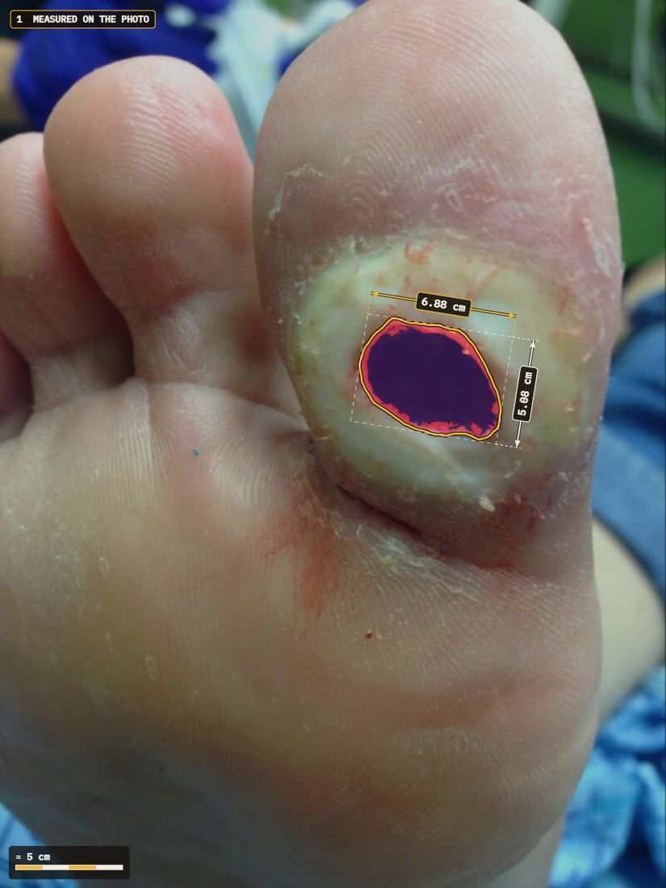
*Anotasi: kontur, garis ukuran dengan label, peta jaringan, skala bar*

Kontur tergambar bertahap (`setLineDash` sepanjang kontur), garis ukuran terbuka dari tengah, label muncul terakhir. Durasi 1700 ms, ease-out kubik.

```ts
/** run draw(p) for p 0..1 over ms with ease-out; resolves at the end */
export function tween(ms: number, draw: (p: number) => void): Promise<void> {
  return new Promise((res) => {
    const t0 = performance.now();
    const step = (t: number) => {
      const x = Math.min(1, (t - t0) / ms);
      draw(1 - Math.pow(1 - x, 3));
      if (x < 1) requestAnimationFrame(step); else res();
    };
    requestAnimationFrame(step);
  });
}
```

**Menggambar anotasi (`plan/draw.ts`, lengkap):**

```ts
/* Canvas drawing of the annotated photo and the surgical marking. Units are working pixels; k scales line widths so
   exports stay crisp. Palette: surgical marker ink, measuring-tape yellow, bone and ink. */
import type { P2 } from './geom';
import type { Plan } from './planner';
import type { Stage } from './raster';
import { lang } from '../i18n';

export const TAPE = '#f2b632';
export const INK = 'rgba(21,17,14,.88)';
const BONE = '#f1ebdd';
const MARK = '#6f5bff';
const MARK2 = '#3d2fd0';
const MONO = '"IBM Plex Mono", ui-monospace, Consolas, monospace';
const SANS = '"Bricolage Grotesque Variable", "Bricolage Grotesque", system-ui, sans-serif';

export function pill(ctx: CanvasRenderingContext2D, x: number, y: number, text: string, k: number, o: { rot?: number; color?: string; bg?: string; txt?: string; size?: number; mono?: boolean } = {}) {
  const fs = (o.size || 12) * k;
  ctx.save();
  ctx.translate(x, y);
  if (o.rot) ctx.rotate(o.rot);
  ctx.font = `600 ${fs}px ${o.mono === false ? SANS : MONO}`;
  const tw = ctx.measureText(text).width, ph = 6 * k, pv = 4 * k;
  const w = tw + 2 * ph, h = fs + 2 * pv;
  ctx.beginPath();
  ctx.roundRect(-w / 2, -h / 2, w, h, 3 * k);
  ctx.fillStyle = o.bg || INK; ctx.fill();
  ctx.lineWidth = 1.1 * k; ctx.strokeStyle = o.color || TAPE; ctx.stroke();
  ctx.fillStyle = o.txt || BONE; ctx.textAlign = 'center'; ctx.textBaseline = 'middle';
  ctx.fillText(text, 0, 0.5 * k);
  ctx.restore();
}

function arrowHead(ctx: CanvasRenderingContext2D, tip: P2, ux: number, uy: number, k: number, size: number) {
  const s = size * k;
  ctx.beginPath();
  ctx.moveTo(tip[0], tip[1]);
  ctx.lineTo(tip[0] - ux * s - uy * s * 0.38, tip[1] - uy * s + ux * s * 0.38);
  ctx.lineTo(tip[0] - ux * s + uy * s * 0.38, tip[1] - uy * s - ux * s * 0.38);
  ctx.closePath();
  ctx.fill();
}

function dim(ctx: CanvasRenderingContext2D, a: P2, b: P2, off: number, text: string, k: number, color: string, centroid: P2, p: number) {
  const dx = b[0] - a[0], dy = b[1] - a[1], Ln = Math.hypot(dx, dy) || 1;
  const ux = dx / Ln, uy = dy / Ln;
  let nx = -uy, ny = ux;
  const mid: P2 = [(a[0] + b[0]) / 2, (a[1] + b[1]) / 2];
  if ((mid[0] + nx * off - centroid[0]) * nx + (mid[1] + ny * off - centroid[1]) * ny < 0) { nx = -nx; ny = -ny; }
  const o = Math.max(off * k, off * k + (74 * k - Ln) / 2);
  const A: P2 = [a[0] + nx * o, a[1] + ny * o], B: P2 = [b[0] + nx * o, b[1] + ny * o];
  const cx = (A[0] + B[0]) / 2, cy = (A[1] + B[1]) / 2;
  const A2: P2 = [cx + (A[0] - cx) * p, cy + (A[1] - cy) * p], B2: P2 = [cx + (B[0] - cx) * p, cy + (B[1] - cy) * p];
  ctx.save();
  ctx.globalAlpha = Math.min(1, p * 1.4);
  ctx.strokeStyle = color; ctx.fillStyle = color; ctx.lineWidth = 1.1 * k;
  ctx.setLineDash([2.5 * k, 3 * k]);
  ctx.beginPath(); ctx.moveTo(a[0], a[1]); ctx.lineTo(A[0] + nx * 5 * k, A[1] + ny * 5 * k); ctx.moveTo(b[0], b[1]); ctx.lineTo(B[0] + nx * 5 * k, B[1] + ny * 5 * k); ctx.stroke();
  ctx.setLineDash([]);
  ctx.strokeStyle = INK; ctx.lineWidth = 3.4 * k; ctx.beginPath(); ctx.moveTo(A2[0], A2[1]); ctx.lineTo(B2[0], B2[1]); ctx.stroke();
  ctx.strokeStyle = color; ctx.lineWidth = 1.7 * k; ctx.beginPath(); ctx.moveTo(A2[0], A2[1]); ctx.lineTo(B2[0], B2[1]); ctx.stroke();
  arrowHead(ctx, A2, -ux, -uy, k, 8); arrowHead(ctx, B2, ux, uy, k, 8);
  ctx.restore();
  if (p > 0.6) {
    let ang = Math.atan2(dy, dx);
    if (ang > Math.PI / 2) ang -= Math.PI;
    if (ang < -Math.PI / 2) ang += Math.PI;
    ctx.save(); ctx.globalAlpha = Math.min(1, (p - 0.6) / 0.4);
    pill(ctx, cx, cy, text, k, { rot: ang, color });
    ctx.restore();
  }
}

const niceLen = (cm: number) => { const v = [0.1, 0.2, 0.5, 1, 2, 5, 10, 20, 50]; let best = v[0]; for (const x of v) if (x <= cm) best = x; return best; };

export function scaleBar(ctx: CanvasRenderingContext2D, W: number, H: number, k: number, cmPerPx: number, approx: boolean) {
  const cm = niceLen(W * 0.2 * cmPerPx), len = cm / cmPerPx;
  const x0 = 18 * k, y0 = H - 26 * k, th = 5 * k;
  ctx.save();
  ctx.fillStyle = 'rgba(21,17,14,.78)'; ctx.beginPath(); ctx.roundRect(x0 - 8 * k, y0 - 22 * k, len + 16 * k, 38 * k, 4 * k); ctx.fill();
  const n = cm >= 1 ? 4 : 2;
  for (let i = 0; i < n; i++) { ctx.fillStyle = i % 2 ? BONE : TAPE; ctx.fillRect(x0 + (len * i) / n, y0, len / n, th); }
  ctx.strokeStyle = BONE; ctx.lineWidth = 1 * k; ctx.strokeRect(x0, y0, len, th);
  ctx.fillStyle = BONE; ctx.font = `600 ${11 * k}px ${MONO}`; ctx.textAlign = 'left';
  ctx.fillText(`${approx ? '≈ ' : ''}${cm >= 1 ? `${cm} cm` : `${cm * 10} mm`}`, x0, y0 - 6 * k);
  ctx.restore();
}

function strokePolys(ctx: CanvasRenderingContext2D, polys: P2[][], k: number, color: string, lw: number, p = 1, dash?: number[]) {
  ctx.save(); ctx.lineJoin = 'round'; ctx.lineCap = 'round';
  for (const poly of polys) {
    ctx.beginPath();
    poly.forEach((q, i) => (i ? ctx.lineTo(q[0], q[1]) : ctx.moveTo(q[0], q[1])));
    ctx.closePath();
    let len = 0;
    for (let i = 0; i < poly.length; i++) { const a = poly[i], b = poly[(i + 1) % poly.length]; len += Math.hypot(b[0] - a[0], b[1] - a[1]); }
    if (p < 1) ctx.setLineDash([len * p, len]); else if (dash) ctx.setLineDash(dash.map((v) => v * k));
    ctx.strokeStyle = INK; ctx.lineWidth = (lw + 2.4) * k; ctx.stroke();
    ctx.strokeStyle = color; ctx.lineWidth = lw * k; ctx.stroke();
  }
  ctx.restore();
}

export interface AnnoOpts { tissue: boolean; contour: boolean; dims: boolean; feret: boolean; scale: boolean; margin?: number; approxScale: boolean; unit: string }

/** p: reveal progress 0..1 (the contour draws on, the dimension lines open, then the labels appear) */
export function annotate(ctx: CanvasRenderingContext2D, st: Stage, k: number, o: AnnoOpts, p = 1) {
  const { W, H, geo } = st;
  if (!geo) return;
  const cm = st.cmPerPx;
  if (o.tissue && st.tissue) { ctx.save(); ctx.globalAlpha = Math.min(1, p * 1.5) * 0.6; ctx.drawImage(st.tissue, 0, 0, W, H); ctx.restore(); }
  else if (o.contour) {
    ctx.save(); ctx.globalAlpha = Math.min(1, p) * 0.9; ctx.fillStyle = 'rgba(242,182,50,.2)'; ctx.beginPath();
    geo.polys.forEach((q) => { q.forEach((v, i) => (i ? ctx.lineTo(v[0], v[1]) : ctx.moveTo(v[0], v[1]))); ctx.closePath(); });
    ctx.fill('evenodd'); ctx.restore();
  }
  if (o.margin && geo.marginPoly(o.margin)) strokePolys(ctx, [geo.marginPoly(o.margin)!], k, '#fb7185', 1.6, 1, [6, 4]);
  if (o.contour) strokePolys(ctx, geo.polys.slice(0, 3), k, TAPE, 2.2, Math.min(1, p / 0.55));
  const f = (px: number) => (px * cm).toFixed(2);
  const cen = geo.centroid;
  if (o.dims) {
    const s = geo.shape, r = s.rect;
    ctx.save(); ctx.globalAlpha = Math.min(1, p * 1.2); ctx.setLineDash([5 * k, 4 * k]); ctx.strokeStyle = 'rgba(241,235,221,.6)'; ctx.lineWidth = 1 * k; ctx.beginPath();
    r.forEach((q, i) => (i ? ctx.lineTo(q[0], q[1]) : ctx.moveTo(q[0], q[1]))); ctx.closePath(); ctx.stroke(); ctx.restore();
    const l1 = Math.hypot(r[1][0] - r[0][0], r[1][1] - r[0][1]), l2 = Math.hypot(r[2][0] - r[1][0], r[2][1] - r[1][1]);
    const dp = Math.max(0, Math.min(1, (p - 0.35) / 0.65));
    dim(ctx, r[0], r[1], 24, `${f(l1)} ${o.unit}`, k, TAPE, cen, dp);
    dim(ctx, r[1], r[2], 24, `${f(l2)} ${o.unit}`, k, BONE, cen, dp);
  }
  if (o.feret) {
    const s = geo.shape;
    ctx.save(); ctx.globalAlpha = Math.min(1, p); ctx.strokeStyle = BONE; ctx.fillStyle = BONE; ctx.lineWidth = 1.2 * k;
    ctx.beginPath(); ctx.moveTo(s.feretA[0], s.feretA[1]); ctx.lineTo(s.feretB[0], s.feretB[1]); ctx.stroke();
    [s.feretA, s.feretB].forEach((q) => { ctx.beginPath(); ctx.arc(q[0], q[1], 3.2 * k, 0, 6.2832); ctx.fill(); });
    ctx.restore();
  }
  if (o.scale) scaleBar(ctx, W, H, k, cm, o.approxScale);
}

/* ---------- surgical marking (sterile marker pen look) ---------- */
function polyPath(ctx: CanvasRenderingContext2D, p: P2[]) { ctx.beginPath(); p.forEach((q, i) => (i ? ctx.lineTo(q[0], q[1]) : ctx.moveTo(q[0], q[1]))); ctx.closePath(); }
function hatch(ctx: CanvasRenderingContext2D, p: P2[], k: number, color: string, gap: number, ang: number) {
  ctx.save(); polyPath(ctx, p); ctx.clip();
  let x0 = 1e9, y0 = 1e9, x1 = -1e9, y1 = -1e9;
  p.forEach((q) => { x0 = Math.min(x0, q[0]); x1 = Math.max(x1, q[0]); y0 = Math.min(y0, q[1]); y1 = Math.max(y1, q[1]); });
  const cx = (x0 + x1) / 2, cy = (y0 + y1) / 2, R = Math.hypot(x1 - x0, y1 - y0);
  ctx.translate(cx, cy); ctx.rotate(ang); ctx.strokeStyle = color; ctx.lineWidth = 1.3 * k;
  for (let t = -R; t <= R; t += gap * k) { ctx.beginPath(); ctx.moveTo(-R, t); ctx.lineTo(R, t); ctx.stroke(); }
  ctx.restore();
}

export function marking(ctx: CanvasRenderingContext2D, pl: Plan, k: number, p = 1) {
  ctx.save(); ctx.lineJoin = 'round'; ctx.lineCap = 'round'; ctx.globalAlpha = Math.min(1, p * 1.3);
  for (const it of pl.items) {
    if (it.t === 'poly' && Array.isArray(it.p) && Array.isArray(it.p[0])) {
      const pp = it.p as P2[];
      if (it.fill === 'excise') { ctx.save(); polyPath(ctx, pp); ctx.fillStyle = 'rgba(244,114,182,.16)'; ctx.fill(); ctx.restore(); hatch(ctx, pp, k, 'rgba(244,114,182,.85)', 5.5, Math.PI / 4); }
      if (it.fill === 'graft') { ctx.save(); polyPath(ctx, pp); ctx.fillStyle = 'rgba(52,211,153,.14)'; ctx.fill(); ctx.restore(); hatch(ctx, pp, k, 'rgba(52,211,153,.6)', 7, -Math.PI / 4); hatch(ctx, pp, k, 'rgba(52,211,153,.35)', 7, Math.PI / 4); }
      if (it.s === 'incise') { polyPath(ctx, pp); ctx.strokeStyle = 'rgba(255,255,255,.92)'; ctx.lineWidth = 4.4 * k; ctx.stroke(); ctx.strokeStyle = MARK; ctx.lineWidth = 2.4 * k; ctx.stroke(); }
      else if (it.s === 'graft') { polyPath(ctx, pp); ctx.setLineDash([6 * k, 4 * k]); ctx.strokeStyle = '#34d399'; ctx.lineWidth = 2 * k; ctx.stroke(); ctx.setLineDash([]); }
      else if (it.s === 'margin') { polyPath(ctx, pp); ctx.strokeStyle = 'rgba(255,255,255,.75)'; ctx.lineWidth = 1.2 * k; ctx.setLineDash([4 * k, 3 * k]); ctx.stroke(); ctx.setLineDash([]); }
    } else if (it.t === 'line' && it.a && it.b) {
      ctx.beginPath(); ctx.moveTo(it.a[0], it.a[1]); ctx.lineTo(it.b[0], it.b[1]);
      const w = it.w || 1.5;
      if (it.s === 'incise') { ctx.strokeStyle = 'rgba(255,255,255,.92)'; ctx.lineWidth = (w + 2.2) * k; ctx.stroke(); ctx.strokeStyle = MARK; ctx.lineWidth = w * k * 1.2; ctx.stroke(); }
      else if (it.s === 'flaptip') { ctx.setLineDash([5 * k, 4 * k]); ctx.strokeStyle = MARK2; ctx.lineWidth = w * k; ctx.stroke(); ctx.setLineDash([]); }
      else if (it.s === 'closure') { ctx.setLineDash([8 * k, 5 * k]); ctx.strokeStyle = '#fde047'; ctx.lineWidth = w * k; ctx.stroke(); ctx.setLineDash([]); }
      else if (it.s === 'stitch') { ctx.strokeStyle = 'rgba(255,255,255,.88)'; ctx.lineWidth = w * k; ctx.setLineDash([3 * k, 3 * k]); ctx.stroke(); ctx.setLineDash([]); }
    } else if (it.t === 'dot' && it.p && !Array.isArray((it.p as P2[])[0])) {
      const q = it.p as unknown as P2;
      ctx.beginPath(); ctx.arc(q[0], q[1], 2.8 * k, 0, 6.2832); ctx.fillStyle = '#fff'; ctx.fill(); ctx.lineWidth = 1.2 * k; ctx.strokeStyle = MARK2; ctx.stroke();
    } else if (it.t === 'arrow' && it.a && it.b) {
      const dx = it.b[0] - it.a[0], dy = it.b[1] - it.a[1], Ln = Math.hypot(dx, dy) || 1, ux = dx / Ln, uy = dy / Ln;
      ctx.strokeStyle = 'rgba(0,0,0,.55)'; ctx.lineWidth = 6 * k; ctx.beginPath(); ctx.moveTo(it.a[0], it.a[1]); ctx.lineTo(it.b[0], it.b[1]); ctx.stroke();
      ctx.strokeStyle = '#fff'; ctx.fillStyle = '#fff'; ctx.lineWidth = 3 * k; ctx.beginPath(); ctx.moveTo(it.a[0], it.a[1]); ctx.lineTo(it.b[0], it.b[1]); ctx.stroke();
      arrowHead(ctx, it.b, ux, uy, k, 13);
    }
  }
  ctx.restore();
  ctx.save();
  pl.items.filter((i) => i.t === 'label').forEach((it) => { const q = it.p as unknown as P2; pill(ctx, q[0], q[1], it.text || '', k, { size: 11, color: MARK2, bg: 'rgba(255,255,255,.95)', txt: '#1c1370' }); });
  ctx.restore();
}

export const unitLabel = () => (lang() === 'id' ? 'cm' : 'cm');
```

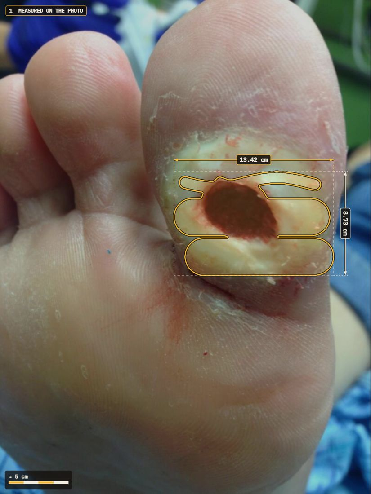
*Kuas kontur: hasil koreksi, semua angka dihitung ulang*

**Garis pemindai pada foto saat analisis (CSS):**

```css
/* running */
.wb-run { display: grid; grid-template-columns: minmax(0, 1.2fr) minmax(0, 1fr); gap: var(--s-8); align-items: center; }
.scan { position: relative; margin: 0; background: #14100d; border-radius: var(--r); overflow: hidden; line-height: 0; box-shadow: 0 30px 60px -30px rgba(20, 14, 8, 0.6); }
.scan img { width: 100%; max-height: 32rem; object-fit: contain; display: block; filter: saturate(0.9) brightness(0.92); }
.scan::after { content: ''; position: absolute; inset: 0; background: linear-gradient(transparent 50%, rgba(10, 8, 6, 0.55)); pointer-events: none; }
.scanline { position: absolute; left: 0; right: 0; top: 0; height: 3px; background: var(--tape); box-shadow: 0 0 22px 6px rgba(242, 182, 50, 0.55); animation: scan 2.2s var(--ease-out, ease) infinite alternate; z-index: 2; }
@keyframes scan { from { top: 2%; } to { top: 98%; } }
.scan figcaption { position: absolute; left: var(--s-4); bottom: var(--s-4); z-index: 3; color: var(--tape); font: 600 0.78rem var(--mono); letter-spacing: 0.08em; text-transform: uppercase; line-height: 1.2; }
.scan-steps { list-style: none; margin: 0; padding: 0; display: grid; gap: var(--s-3); }
.scan-steps li { display: flex; align-items: center; gap: var(--s-3); font: 500 1rem var(--font); color: #9a8f82; transition: color 300ms, transform 300ms; }
.scan-steps li.on { color: var(--ink); transform: translateX(4px); }
.scan-steps .dot { width: 0.7rem; height: 0.7rem; border-radius: 50%; border: 1.5px solid currentColor; flex: none; transition: background 300ms; }
.scan-steps li.on .dot { background: var(--tape-deep); border-color: var(--tape-deep); }
```

**Bilah diagnosis banding dan pertanyaan klinis (CSS):**

```css
.diff { list-style: none; margin: 0 0 var(--s-4); padding: 0; display: grid; gap: 0.55rem; }
.diff li { display: grid; gap: 0.2rem; }
.dr-top { display: flex; justify-content: space-between; align-items: baseline; font-size: 0.95rem; }
.dr-top span { font: 600 0.8rem var(--mono); color: var(--ink-2); }
.diff i { display: block; height: 5px; border-radius: 3px; background: #2d2722; position: relative; overflow: hidden; }
.diff i::after { content: ''; position: absolute; inset: 0 auto 0 0; width: var(--w); background: var(--tape); border-radius: 3px; transition: width 500ms; }
.diff li:first-child i::after { background: #ffd05a; }
.diff small { font-size: 0.76rem; color: var(--ink-2); line-height: 1.4; }
.clinq, .rh-type { margin-bottom: var(--s-3); }
.clinq summary, .rh-type summary { cursor: pointer; font: 600 0.85rem/1.4 var(--font); color: var(--ink-2); }
.cq-grid { display: grid; grid-template-columns: repeat(2, minmax(0, 1fr)); gap: 0.4rem 1rem; margin-top: var(--s-3); }
.cq { display: flex; gap: 0.5rem; align-items: flex-start; font: 500 0.86rem/1.4 var(--font); color: var(--ink); cursor: pointer; }
.cq input { margin-top: 0.2rem; accent-color: var(--tape); width: 15px; height: 15px; flex: none; }
.neo { margin: var(--s-2) 0 0; padding-left: 1.2rem; display: grid; gap: 0.4rem; font-size: 0.86rem; }
.neo small { display: block; color: var(--ink-2); font-size: 0.78rem; line-height: 1.45; }
```

## 7. Tiga panel rencana (marking dan hasil)

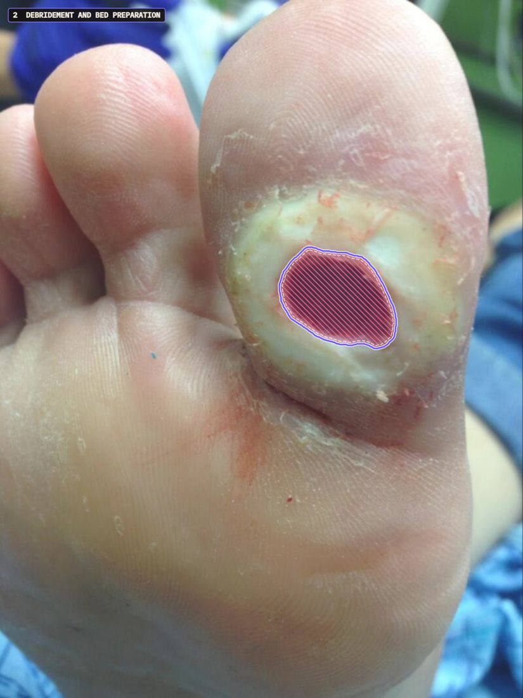
*Marking debridemen: garis sayat ungu, arsir merah muda*

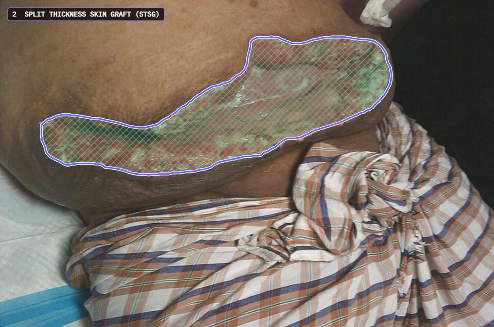
*Marking STSG: arsir hijau silang pada area cangkok*


*Marking flap advancement: panah, garis sayat, area flap*

Fungsi `marking()` menggambar garis sayat dengan tepi putih dan inti ungu, arsir area eksisi dan cangkok, panah gerak, titik, dan label (di `plan/draw.ts`, sudah termasuk di bagian 6).


## 8. Penampil 3D operasi (dibangun dari foto yang diunggah)

### 8.1 Permukaan: kulit dari foto, potongan flap dan graft

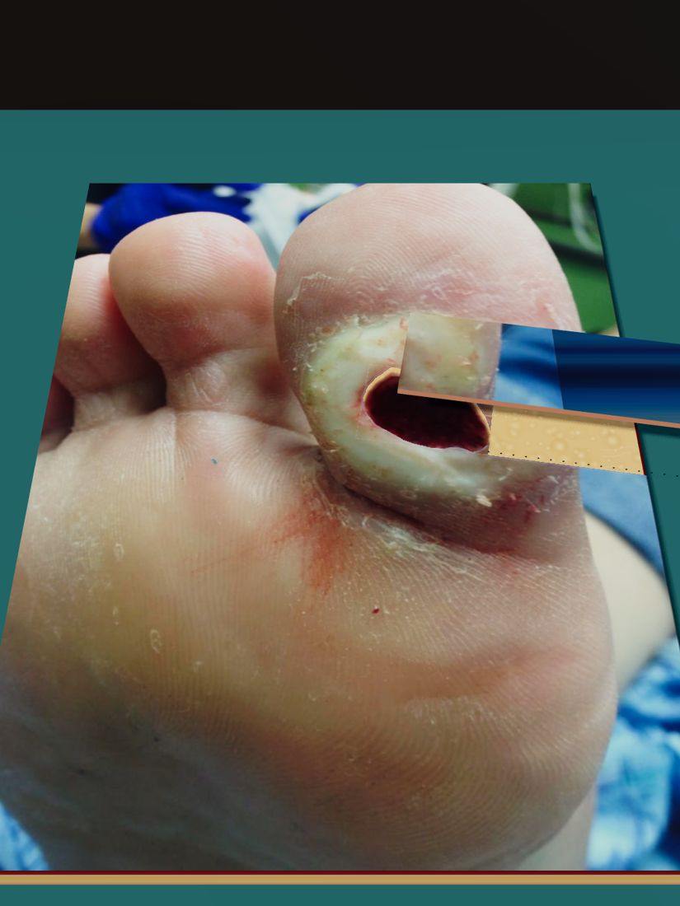
*Flap diangkat, membawa piksel kulit dari foto*

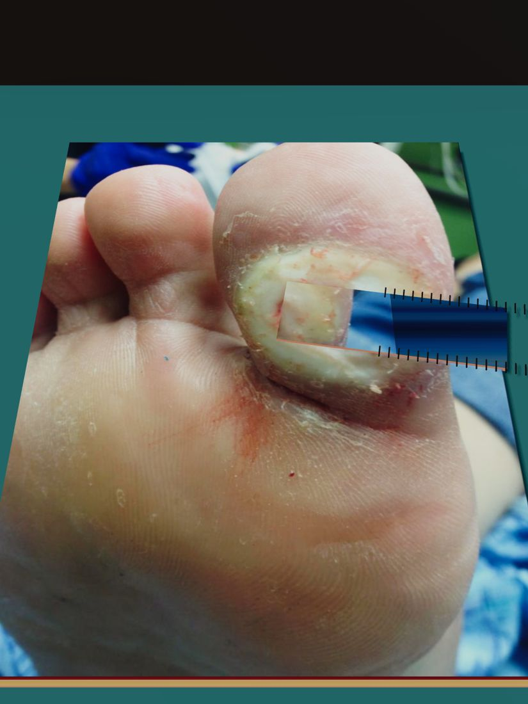
*Flap sudah masuk ke defek, jahitan tumbuh satu per satu*

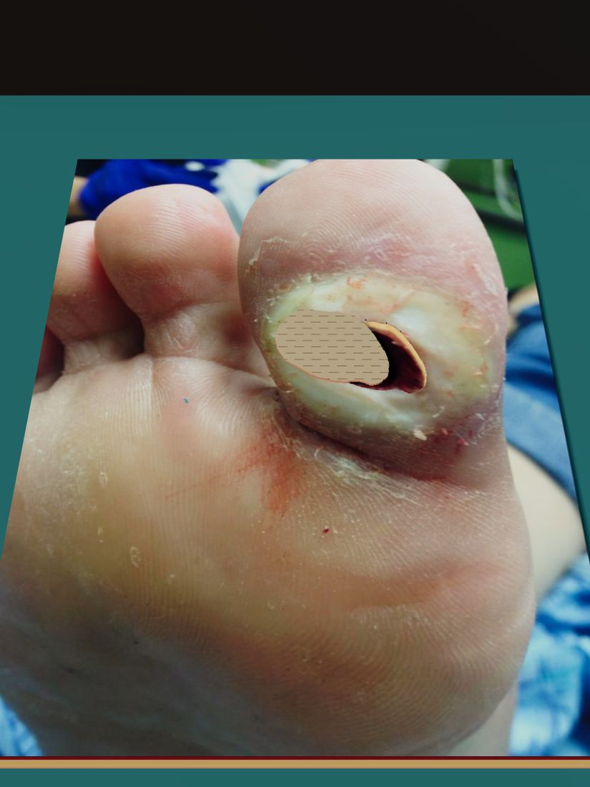
*Cangkok terbang dari area donor ke dasar luka*

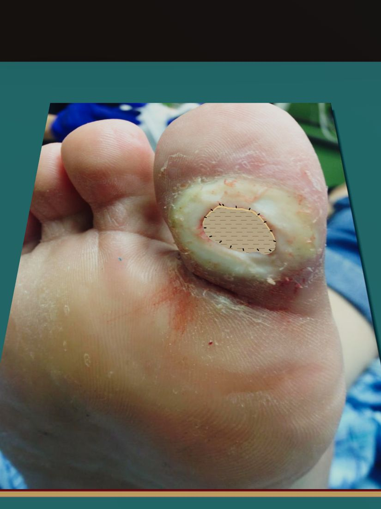
*Cangkok mendarat, staples melingkar di tepi*

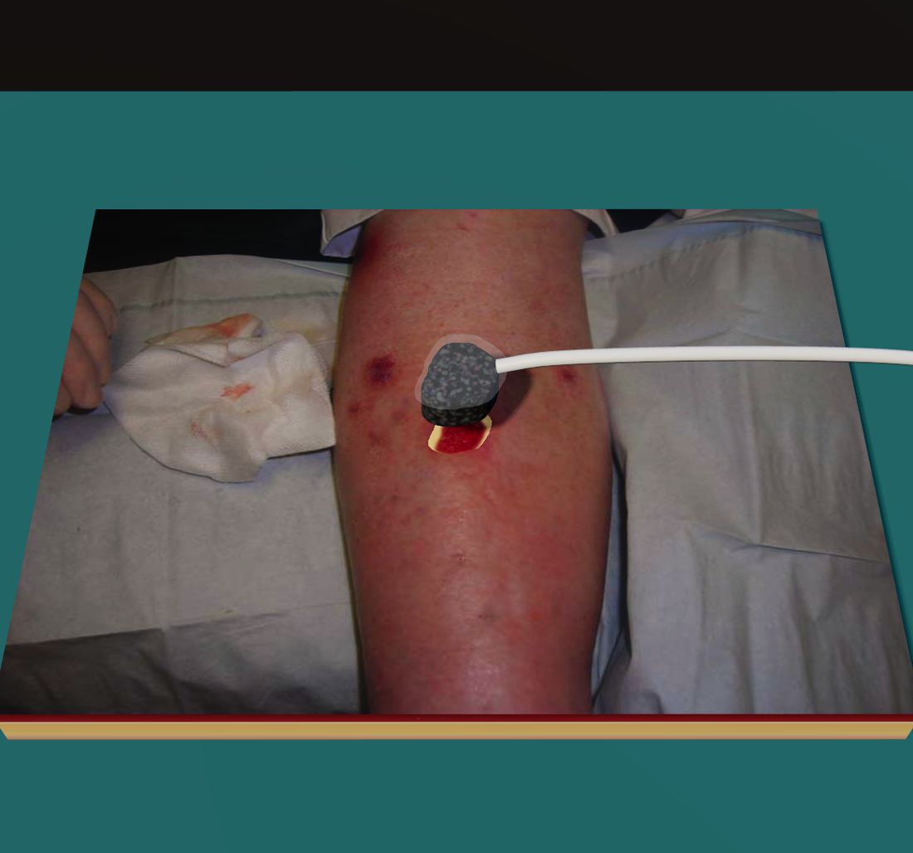
*Tekanan negatif: busa berpori, film transparan, selang hisap*

**Material kulit: foto sebagai tekstur, lubang di bawah potongan, lapisan marking dicampur lewat uniform:**

```ts
  const uMarkAmt = { value: 0 };
  const skinMat = new THREE.MeshStandardMaterial({ map: skinTex, roughness: 0.62, metalness: 0, side: THREE.DoubleSide });
  skinMat.onBeforeCompile = (sh) => {
    sh.uniforms.uHole = { value: holeTex }; sh.uniforms.uMark = { value: markTex }; sh.uniforms.uMarkAmt = uMarkAmt;
    sh.vertexShader = sh.vertexShader.replace('#include <common>', '#include <common>\nvarying vec2 vUv2;').replace('#include <begin_vertex>', '#include <begin_vertex>\nvUv2 = uv;');
    sh.fragmentShader = sh.fragmentShader
      .replace('#include <common>', '#include <common>\nvarying vec2 vUv2; uniform sampler2D uHole; uniform sampler2D uMark; uniform float uMarkAmt;')
      .replace('#include <map_fragment>', `#include <map_fragment>
        if (texture2D(uHole, vUv2).r > 0.5) discard;
        vec4 mk = texture2D(uMark, vUv2);
        diffuseColor.rgb = mix(diffuseColor.rgb, mk.rgb, mk.a * uMarkAmt);
        if (!gl_FrontFacing) diffuseColor.rgb = vec3(0.80, 0.50, 0.44);`);
  };
```

**Kupas kulit seperti halaman (page curl):**

```ts
    // peel: page curl of the skin sheet
    const R = 0.42, front = WU / 2 - peelV * (WU * 1.02), p = pos.array as Float32Array;
    for (let i = 0; i < pos.count; i++) {
      const bx = base[i * 3], by = base[i * 3 + 1], bz = base[i * 3 + 2];
      let x = bx, z = bz; const d = bx - front;
      if (peelV > 0.001 && d > 0) { if (d <= R * Math.PI) { const a2 = d / R; x = front + R * Math.sin(a2); z = bz + R * (1 - Math.cos(a2)); } else { x = front - (d - R * Math.PI); z = bz + 2 * R; } }
      p[i * 3] = x; p[i * 3 + 1] = by; p[i * 3 + 2] = z;
    }
```

**Kamera menyesuaikan diri dengan ukuran foto dan layar:**

```ts
  const fitHome = () => {
    const th = Math.tan((camera.fov * Math.PI) / 360), el = 0.95;
    const dW = (WU / 2) / (th * camera.aspect), dH = (Hu / 2) / th;
    const d = Math.max(dW, dH * 0.8) * 1.12;
    homeS.set(0, d * Math.sin(el), d * Math.cos(el));
    const dc = Math.max((2.9) / (th * camera.aspect), 1.7 / th) * 1.2;
    homeC.set(0.4, dc * 0.42, dc * 0.92);
    if (mode === 'surface') { controls.minDistance = d * 0.3; controls.maxDistance = d * 2; } else { controls.minDistance = dc * 0.3; controls.maxDistance = dc * 2; }
  };
```

**Busa tekanan negatif, film, dan selang (`viewer3d.ts`):**

```ts
  /* ---- dressings that belong to the stage: foam under suction, bolster, gauze ---- */
  const kindS = kindOf(cs);
  const dressPoly = (cs.geo.marginPoly(3) || cs.geo.poly).map((q) => pxToWorld(q, W, H, Hu));
  const dressG = new THREE.Group(); dressG.visible = false; sheet.add(dressG);
  const foamTex = (() => {
    const c = document.createElement('canvas'); c.width = 128; c.height = 128; const g = c.getContext('2d')!;
    const dark = kindS === 'debride';
    g.fillStyle = dark ? '#26282d' : kindS === 'graft' ? '#8fb0c4' : '#efeae0'; g.fillRect(0, 0, 128, 128);
    const r = rng(21);
    for (let i = 0; i < 260; i++) { g.beginPath(); g.fillStyle = dark ? `rgba(${70 + r() * 40 | 0},${72 + r() * 40 | 0},${80 + r() * 40 | 0},.55)` : `rgba(255,255,255,.35)`; g.arc(r() * 128, r() * 128, 1.5 + r() * 4, 0, 6.3); g.fill(); g.beginPath(); g.fillStyle = 'rgba(0,0,0,.25)'; g.arc(r() * 128, r() * 128, 1 + r() * 2.5, 0, 6.3); g.fill(); }
    const t = new THREE.CanvasTexture(c); t.wrapS = t.wrapT = THREE.RepeatWrapping; t.repeat.set(3, 3); t.colorSpace = THREE.SRGBColorSpace; return t;
  })();
  const thick = kindS === 'debride' || kindS === 'graft' ? 0.16 : 0.035;
  let dressMesh: THREE.Mesh | null = null, filmMesh: THREE.Mesh | null = null, tubeMesh: THREE.Mesh | null = null;
  try {
    const dg = new THREE.ExtrudeGeometry(new THREE.Shape(dressPoly), { depth: thick, bevelEnabled: true, bevelSize: 0.012, bevelThickness: 0.012, bevelSegments: 2, curveSegments: 8 });
    dressMesh = new THREE.Mesh(dg, new THREE.MeshStandardMaterial({ map: foamTex, roughness: 1, bumpMap: foamTex, bumpScale: 1.2 }));
    dressMesh.castShadow = true; dressG.add(dressMesh);
    if (kindS === 'debride' || kindS === 'graft') {
      const fg = new THREE.ShapeGeometry(new THREE.Shape(dressPoly.map((q) => q.clone().sub(new THREE.Vector2(cs.geo.centroid[0] / W * WU - WU / 2, -(cs.geo.centroid[1] / H * Hu - Hu / 2))).multiplyScalar(1.28).add(new THREE.Vector2(cs.geo.centroid[0] / W * WU - WU / 2, -(cs.geo.centroid[1] / H * Hu - Hu / 2))))));
      filmMesh = new THREE.Mesh(fg, new THREE.MeshPhysicalMaterial({ color: '#cfe8ff', transparent: true, opacity: 0.3, roughness: 0.05, clearcoat: 1, side: THREE.DoubleSide, depthWrite: false }));
      filmMesh.position.z = thick + 0.03; dressG.add(filmMesh);
      if (kindS === 'debride') {
        let rx = -1e9, ry = 0; dressPoly.forEach((q) => { if (q.x > rx) { rx = q.x; ry = q.y; } });
        const curve = new THREE.CatmullRomCurve3([new THREE.Vector3(rx, ry, thick + 0.03), new THREE.Vector3(rx + 0.25, ry, thick + 0.09), new THREE.Vector3(WU / 2 + 0.2, ry + 0.1, 0.12), new THREE.Vector3(WU / 2 + 0.9, ry + 0.1, -0.1)]);
        tubeMesh = new THREE.Mesh(new THREE.TubeGeometry(curve, 40, 0.035, 8, false), new THREE.MeshStandardMaterial({ color: '#e8eef2', roughness: 0.35 }));
        dressG.add(tubeMesh);
      }
    }
  } catch { /* a degenerate outline simply has no dressing */ }
  void filmMesh; void tubeMesh;
```

### 8.2 Potongan lapisan: jahitan tiga lapis dan tahap operasi

Lapisan: epidermis, dermis, lemak subkutan, fasia, otot. Jahitan: **dalam (subkutan, ungu)**, **dermal (subdermal, teal)**, **kulit (hitam, paling luar)**. Tahap operasi (`timeline()`) berbeda untuk tutup primer, flap, graft, debridemen, biopsi, dan sembuh sekunder; teks tahap yang sama muncul di panel penjelasan yang bisa diklik.

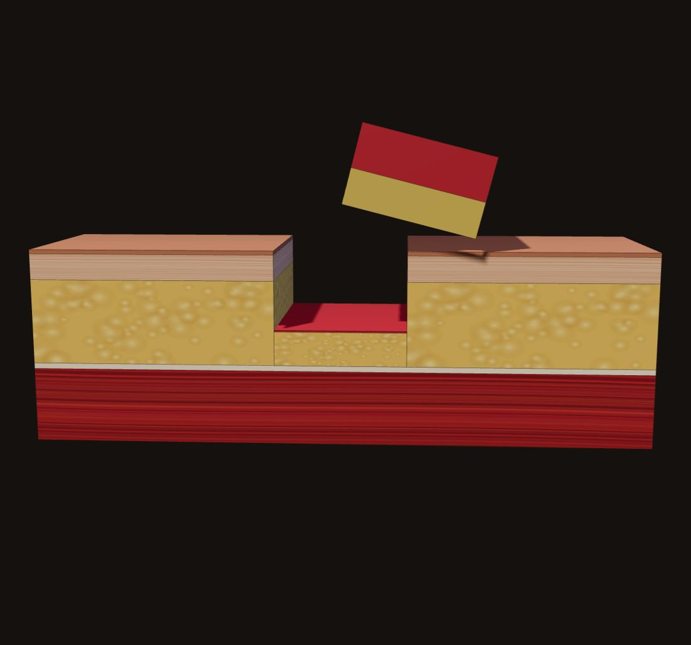
*Eksisi: lesi terangkat keluar dari irisan lapisan*

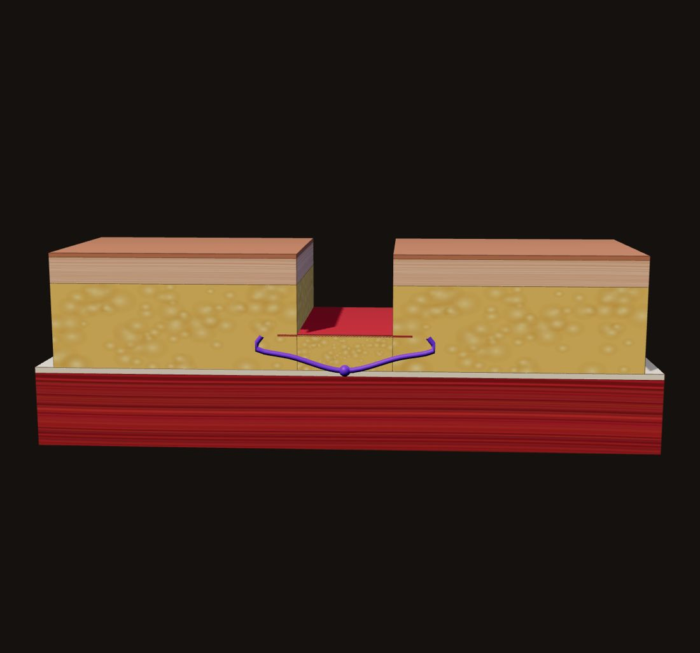
*Lapis 1: jahitan dalam (ungu) dengan simpul terkubur*

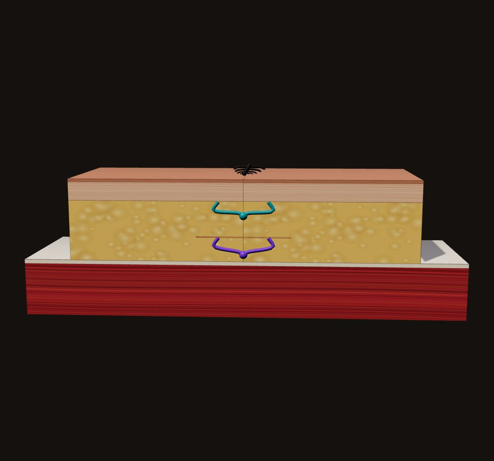
*Tiga lapis jahitan: dalam, dermal, kulit*

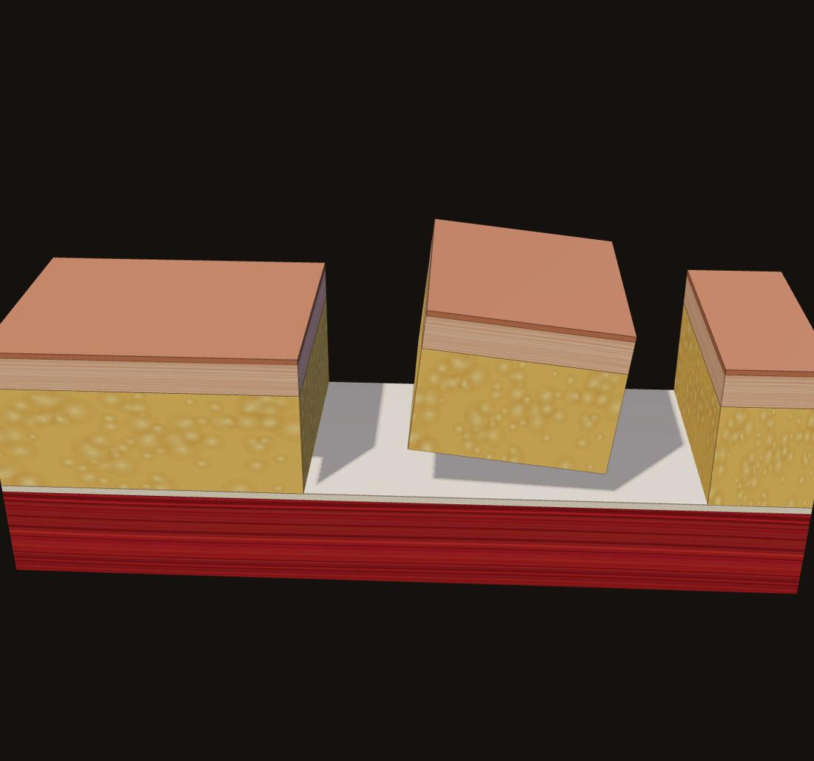
*Flap: elevasi dari fasia*

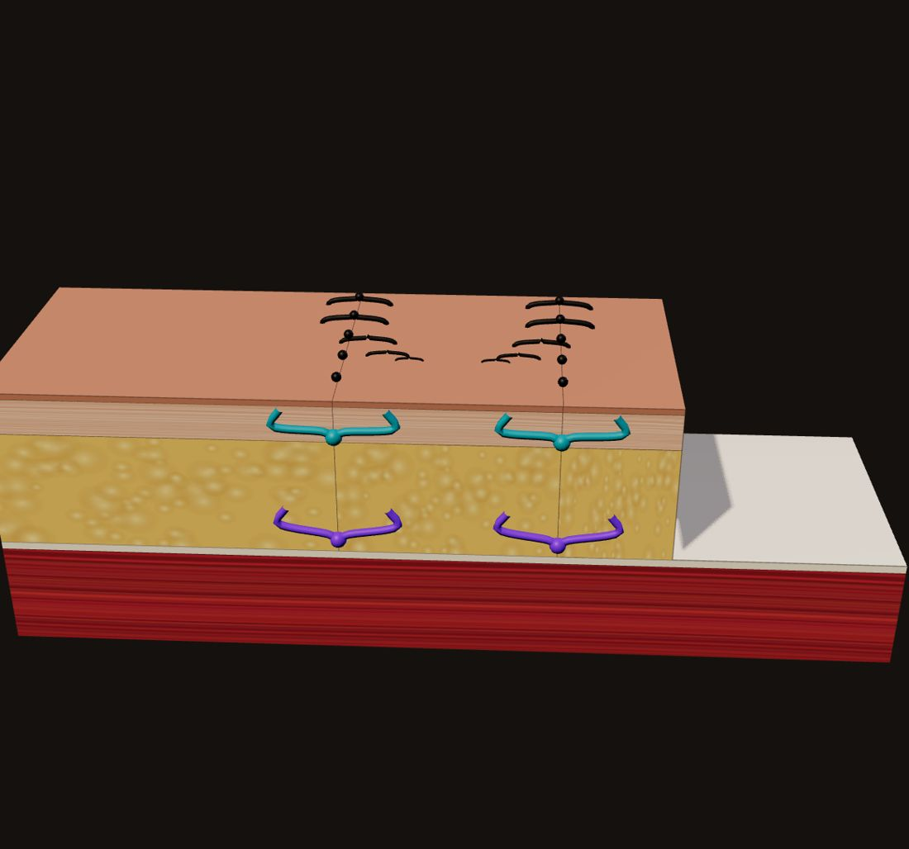
*Flap: jahitan tiga lapis di dua antarmuka*

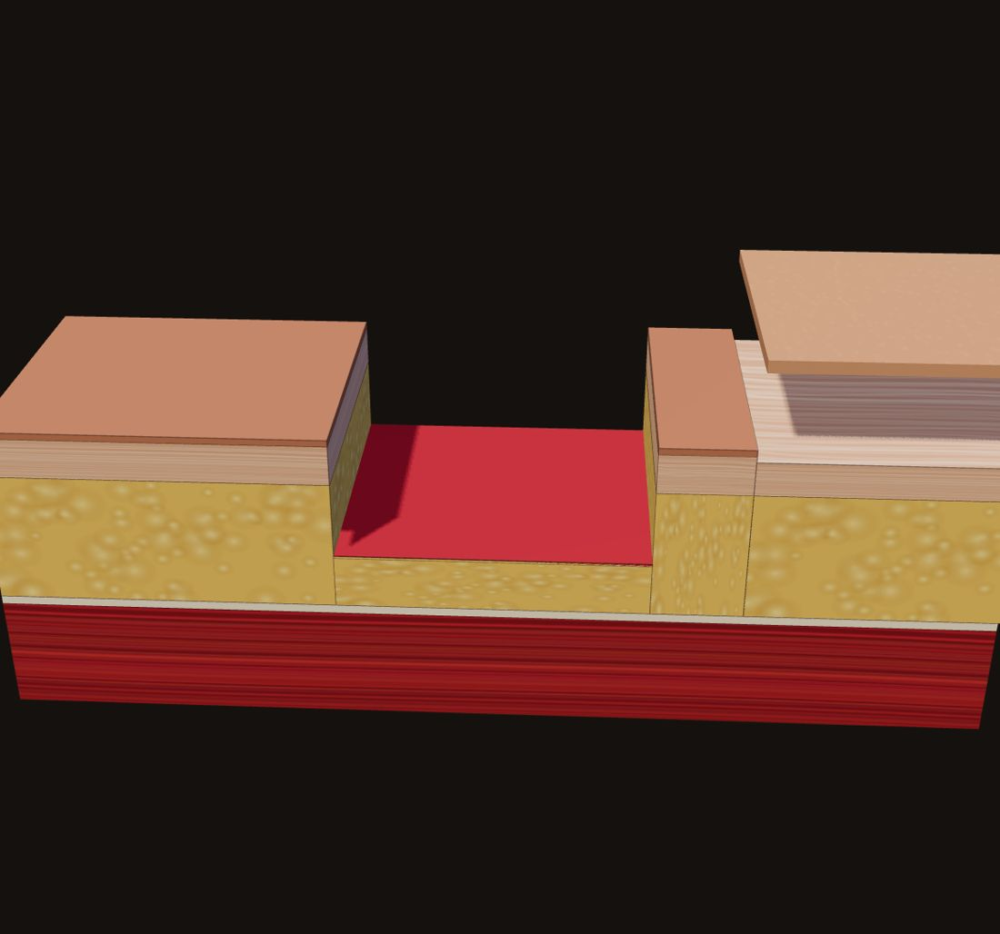
*Graft: lembar donor terangkat, dasar donor mentah, meshing*

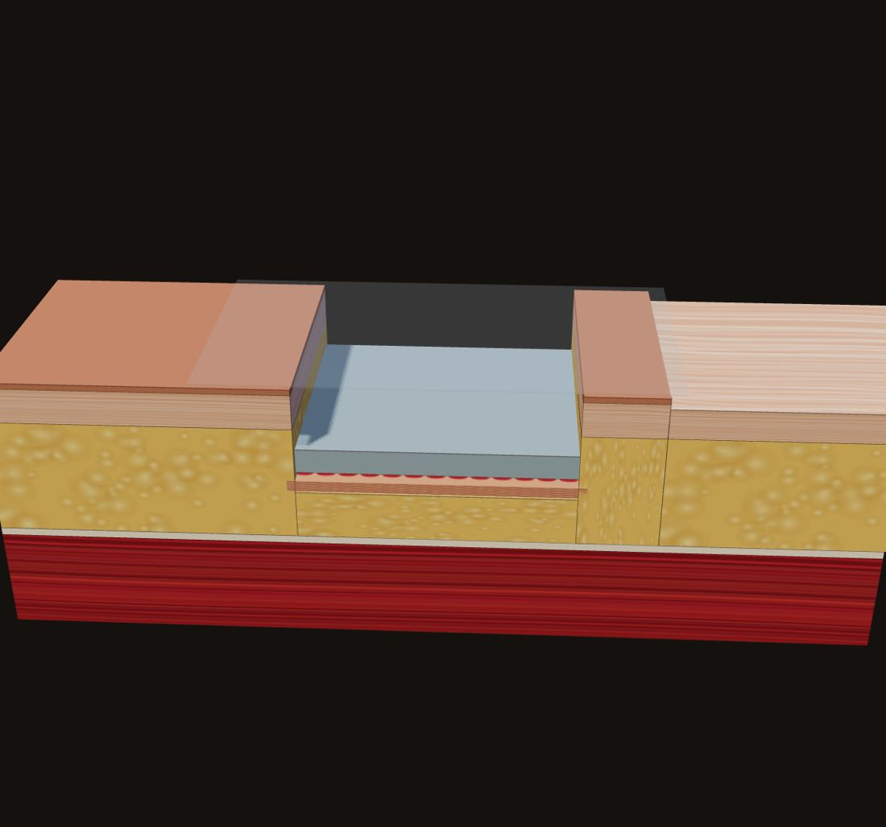
*Graft: bolster busa dan film di atas cangkok*

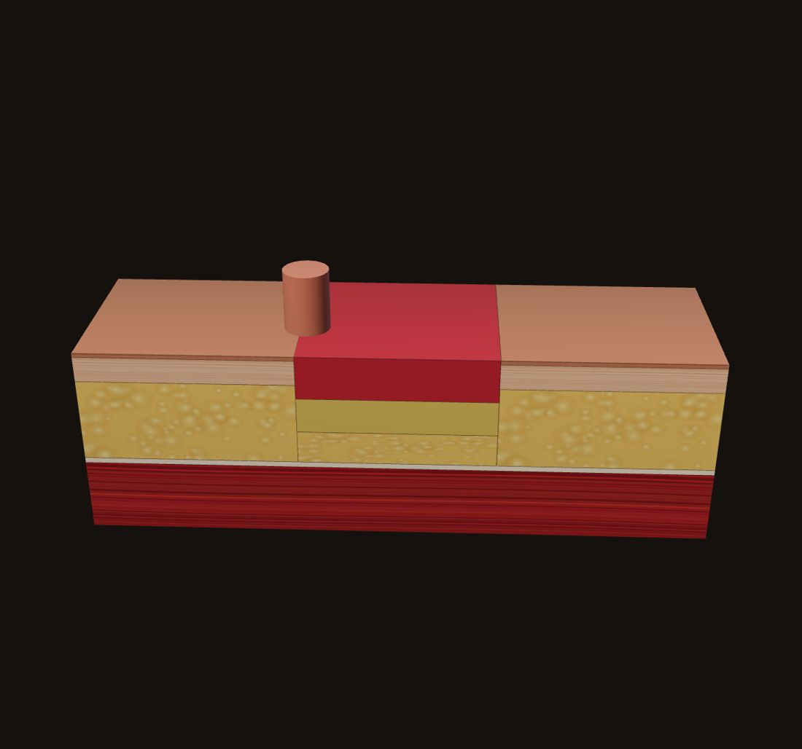
*Biopsi: punch 4 mm mengeluarkan inti jaringan*


**`plan/cutaway.ts` (lengkap: tahap, tekstur lapisan, jahitan, staples, busa, punch):**

```ts
/* Layered cross-section of the operation, built from this case: how deep the wound is (estimate), which technique was
   chosen, and the order in which the layers are closed: deep (subcutaneous), dermal (subdermal), skin (outermost). */
import * as THREE from 'three';
import type { Case } from '../clinic/engine';
import type { L2 } from '../clinic/kb';
import { lang } from '../i18n';

const L = (en: string, id: string): L2 => ({ en, id });
const ease = (x: number) => (x < 0 ? 0 : x > 1 ? 1 : x * x * (3 - 2 * x));
const seg = (t: number, a: number, b: number) => ease((t - a) / (b - a));
const lerp = (a: number, b: number, k: number) => a + (b - a) * k;

export type Kind = 'closure' | 'flap' | 'graft' | 'debride' | 'secondary' | 'biopsy';
export interface Stage { id: string; t0: number; t1: number; title: L2; body: L2; layer?: 'deep' | 'dermal' | 'skin' }
export interface Timeline { kind: Kind; stages: Stage[]; win: Record<string, [number, number]> }

export function kindOf(cs: Case): Kind {
  const t = cs.plan.tech;
  if (t === 'biopsy') return 'biopsy';
  return t === 'stsg' || t === 'ftsg' ? 'graft' : ['adv', 'vy', 'z', 'flapbesar'].includes(t) ? 'flap' : t === 'debridemen' ? 'debride' : t === 'sekunder' ? 'secondary' : 'closure';
}

export function timeline(cs: Case): Timeline {
  const kind = kindOf(cs), d = (cs.depthEst.mm / 10).toFixed(1);
  const layerEn = cs.depthEst.layer === 'dermis' ? 'the dermis' : cs.depthEst.layer === 'subcutis' ? 'the fat layer' : 'the fascia or deeper';
  const layerId = cs.depthEst.layer === 'dermis' ? 'dermis' : cs.depthEst.layer === 'subcutis' ? 'lapisan lemak' : 'fasia atau lebih dalam';
  const mk = (id: string, a: number, b: number, title: L2, body: L2, layer?: Stage['layer']): Stage => ({ id, t0: a, t1: b, title, body, layer });
  const deep = L('3-0 absorbable (for example Vicryl or Monocryl), interrupted, knots buried. These close the dead space and carry the tension so the skin does not have to.', '3-0 absorbable (misalnya Vicryl atau Monocryl), interrupted, simpul terkubur. Jahitan ini menutup ruang mati dan menanggung tegangan agar kulit tidak menanggungnya.');
  const dermal = L('4-0 absorbable, interrupted, placed in the deep dermis (subdermal). They bring the dermal edges together and turn the edge slightly outward so the scar sits flat.', '4-0 absorbable, interrupted, di dermis dalam (subdermal). Jahitan ini mempertemukan tepi dermis dan mengeversikan tepi sedikit agar bekas luka rata.');
  const skin = L('The outermost layer: 4-0 or 5-0 nylon or polypropylene, simple interrupted or vertical mattress, spaced by site. Removal after 5 to 14 days depending on the site.', 'Lapisan paling luar: nilon atau polipropilen 4-0 atau 5-0, simple interrupted atau vertical mattress, jarak sesuai lokasi. Dilepas 5 sampai 14 hari tergantung lokasi.');
  const mark = mk('mark', 0, 0.14, L('Marking', 'Marking'), L('Lines are drawn on the skin with a sterile marker before the first cut: the wound edge, the margin and the closing line. They are drawn from this photo.', 'Garis digambar di kulit dengan spidol steril sebelum sayatan pertama: tepi luka, margin, dan garis penutupan. Garis ini digambar dari foto ini.'));
  let stages: Stage[] = [], win: Timeline['win'] = {};
  if (kind === 'closure') {
    win = { cut: [0.14, 0.36], under: [0.36, 0.5], deep: [0.5, 0.62], dermal: [0.62, 0.74], skin: [0.74, 0.9], dress: [0.9, 1] };
    stages = [mark,
      mk('cut', 0.14, 0.36, L('Excision', 'Eksisi'), L(`The wound edge is cut out to bleeding tissue. Here the defect reaches ${layerEn} (estimated depth about ${d} cm).`, `Tepi luka dieksisi hingga jaringan berdarah. Di sini defek mencapai ${layerId} (perkiraan kedalaman sekitar ${d} cm).`)),
      mk('under', 0.36, 0.5, L('Undermining', 'Undermining'), L('Skin and fat are released from the fascia below so the two edges meet without tension.', 'Kulit dan lemak dibebaskan dari fasia di bawahnya agar kedua tepi bertemu tanpa tegangan.')),
      mk('deep', 0.5, 0.62, L('Layer 1: deep (subcutaneous) sutures', 'Lapis 1: jahitan dalam (subkutan)'), deep, 'deep'),
      mk('dermal', 0.62, 0.74, L('Layer 2: dermal (subdermal) sutures', 'Lapis 2: jahitan dermal (subdermal)'), dermal, 'dermal'),
      mk('skin', 0.74, 0.9, L('Layer 3: skin sutures', 'Lapis 3: jahitan kulit'), skin, 'skin'),
      mk('dress', 0.9, 1, L('Dressing', 'Dressing'), L('A non-adherent or silicone dressing covers the closure. Keep it dry for 48 hours; sutures come out by site (5 to 14 days).', 'Dressing non-lengket atau silikon menutup jahitan. Jaga tetap kering 48 jam; jahitan dilepas sesuai lokasi (5 sampai 14 hari).'))];
  } else if (kind === 'flap') {
    win = { cut: [0.12, 0.3], lift: [0.3, 0.44], move: [0.44, 0.62], deep: [0.62, 0.72], dermal: [0.72, 0.8], skin: [0.8, 0.92], dress: [0.92, 1] };
    stages = [mark,
      mk('cut', 0.12, 0.3, L('Incision of the flap and the defect', 'Sayatan flap dan defek'), L('The defect is excised and the flap is cut along the marked lines, keeping the base (pedicle) attached.', 'Defek dieksisi dan flap disayat sepanjang garis marking, dasar (pedikel) tetap menempel.')),
      mk('lift', 0.3, 0.44, L('Elevation', 'Elevasi'), L('The flap is lifted off the fascia with its fat and blood supply. Perforators at the base are protected.', 'Flap diangkat dari fasia bersama lemak dan pasokan darahnya. Perforator di dasar dilindungi.')),
      mk('move', 0.44, 0.62, L('Transposition', 'Transposisi'), L('The flap slides into the defect without twisting its base. The gap it leaves behind is closed in the next steps.', 'Flap digeser ke defek tanpa memutar dasarnya. Celah yang ditinggalkan ditutup pada langkah berikutnya.')),
      mk('deep', 0.62, 0.72, L('Layer 1: deep (subcutaneous) sutures', 'Lapis 1: jahitan dalam (subkutan)'), deep, 'deep'),
      mk('dermal', 0.72, 0.8, L('Layer 2: dermal (subdermal) sutures', 'Lapis 2: jahitan dermal (subdermal)'), dermal, 'dermal'),
      mk('skin', 0.8, 0.92, L('Layer 3: skin sutures', 'Lapis 3: jahitan kulit'), skin, 'skin'),
      mk('dress', 0.92, 1, L('Dressing', 'Dressing'), L('A non-adherent or silicone dressing covers the closure. Keep it dry for 48 hours; sutures come out by site (5 to 14 days).', 'Dressing non-lengket atau silikon menutup jahitan. Jaga tetap kering 48 jam; jahitan dilepas sesuai lokasi (5 sampai 14 hari).'))];
  } else if (kind === 'graft') {
    win = { harvest: [0.12, 0.3], mesh: [0.3, 0.4], place: [0.4, 0.62], fix: [0.62, 0.76], bolster: [0.76, 1] };
    stages = [mk('prep', 0, 0.12, L('Bed preparation', 'Persiapan dasar'), L('Dead tissue and slough are removed until the bed bleeds and is red and granular. A graft only takes on a bed with its own blood supply.', 'Jaringan mati dan slough dibuang hingga dasar berdarah, merah, dan granuler. Cangkok hanya hidup pada dasar yang berpembuluh.')),
      mk('harvest', 0.12, 0.3, L('Harvest from the donor site', 'Pengambilan dari area donor'), L('A dermatome shaves a thin sheet (0.2 to 0.3 mm) of skin, usually from the thigh. The donor site heals on its own like a graze.', 'Dermatom menyayat selembar kulit tipis (0,2 sampai 0,3 mm), biasanya dari paha. Area donor sembuh sendiri seperti lecet.')),
      mk('mesh', 0.3, 0.4, L('Meshing', 'Meshing'), L('The sheet is passed through a mesher (about 1 to 1.5) so it stretches to cover more area and lets fluid out.', 'Lembaran dilewatkan mesher (sekitar 1 banding 1,5) agar meregang menutup area lebih luas dan cairan bisa keluar.')),
      mk('place', 0.4, 0.62, L('Placement on the bed', 'Penempatan di dasar'), L('The graft is laid on the bed with the dermal side down and trimmed to the shape of the defect.', 'Cangkok diletakkan di dasar dengan sisi dermis di bawah dan dipangkas sesuai bentuk defek.')),
      mk('fix', 0.62, 0.76, L('Fixation at the edge', 'Fiksasi di tepi'), L('Staples or 4-0 absorbable sutures hold the edge. These are the only stitches: a graft has no deep layers to close.', 'Staples atau jahitan absorbable 4-0 memegang tepi. Hanya ini jahitannya: cangkok tidak punya lapisan dalam untuk dijahit.'), 'skin'),
      mk('bolster', 0.76, 1, L('Bolster or negative pressure', 'Bolster atau tekanan negatif'), L('A foam bolster or negative pressure dressing presses the graft onto the bed for 5 to 7 days so it cannot slide or collect fluid beneath.', 'Bolster busa atau dressing tekanan negatif menekan cangkok ke dasar selama 5 sampai 7 hari agar tidak bergeser atau menampung cairan.'))];
  } else if (kind === 'debride') {
    win = { cut: [0.15, 0.5], bed: [0.5, 0.65], npwt: [0.65, 1] };
    stages = [mark,
      mk('cut', 0.15, 0.5, L('Sharp debridement', 'Debridemen tajam'), L('Necrotic tissue and slough are cut away down to bleeding tissue, layer by layer. Perfusion is checked before cutting.', 'Jaringan nekrotik dan slough dipotong hingga jaringan berdarah, lapis demi lapis. Perfusi diperiksa sebelum memotong.')),
      mk('bed', 0.5, 0.65, L('Irrigation and a fresh bed', 'Irigasi dan dasar yang segar'), L('The bed is washed out and a deep tissue sample is taken for culture. Reconstruction waits until the bed is clean.', 'Dasar dibilas dan sampel jaringan dalam diambil untuk kultur. Rekonstruksi menunggu dasar bersih.')),
      mk('npwt', 0.65, 1, L('Negative pressure dressing', 'Dressing tekanan negatif'), L('A foam dressing under suction keeps the bed clean and builds granulation until a graft or flap can be done.', 'Dressing busa dengan hisapan menjaga dasar bersih dan membangun granulasi sampai cangkok atau flap bisa dikerjakan.'))];
  } else if (kind === 'biopsy') {
    win = { cut: [0.15, 0.5], dress: [0.55, 0.85] };
    stages = [mark,
      mk('cut', 0.15, 0.5, L('Punch biopsy', 'Biopsi punch'), L('A 4 mm punch is rotated through the edge of the lesion into the fat, taking tissue and normal skin together. Several sites for a large lesion.', 'Punch 4 mm diputar melalui tepi lesi hingga lemak, mengambil jaringan beserta kulit normal. Beberapa lokasi untuk lesi besar.')),
      mk('dress', 0.5, 1, L('Specimen and dressing', 'Spesimen dan dressing'), L('The cores go to pathology in formalin. The small defects are closed with one suture each or left to heal under a dressing. Nothing is reconstructed until the result is back.', 'Spesimen dikirim ke patologi dalam formalin. Defek kecil dijahit satu jahitan atau dibiarkan sembuh di bawah dressing. Tidak ada rekonstruksi sebelum hasil keluar.'))];
  } else {
    win = { dress: [0, 1] };
    stages = [mk('dress', 0, 1, L('Moist dressing and follow-up', 'Dressing lembap dan kontrol'), L('The wound heals from the base up under a moist non-stick dressing. Measure it at every visit and compare.', 'Luka sembuh dari dasar ke atas di bawah dressing lembap non-lengket. Ukur setiap kunjungan dan bandingkan.'))];
  }
  return { kind, stages, win };
}

export function stageAt(tl: Timeline, t: number): Stage {
  return tl.stages.find((s) => t >= s.t0 && t < s.t1) || tl.stages[tl.stages.length - 1];
}

/* ---------------- textures ---------------- */
function rng(seed: number) { let s = seed >>> 0; return () => ((s = (s * 1664525 + 1013904223) >>> 0) / 4294967296); }
function tex(draw: (g: CanvasRenderingContext2D, r: () => number) => void, w = 256, h = 128) {
  const c = document.createElement('canvas'); c.width = w; c.height = h;
  const g = c.getContext('2d')!; draw(g, rng(5));
  const t = new THREE.CanvasTexture(c); t.colorSpace = THREE.SRGBColorSpace; t.anisotropy = 4; return t;
}
const fatTex = () => tex((g, r) => { g.fillStyle = '#efcb74'; g.fillRect(0, 0, 256, 128); for (let i = 0; i < 90; i++) { const x = r() * 256, y = r() * 128, q = 6 + r() * 14; const gr = g.createRadialGradient(x, y, 1, x, y, q); gr.addColorStop(0, 'rgba(255,236,170,.7)'); gr.addColorStop(1, 'rgba(200,150,60,0)'); g.fillStyle = gr; g.beginPath(); g.arc(x, y, q, 0, 6.3); g.fill(); } });
const dermTex = () => tex((g, r) => { g.fillStyle = '#e2b39b'; g.fillRect(0, 0, 256, 128); g.strokeStyle = 'rgba(255,235,220,.35)'; for (let i = 0; i < 70; i++) { g.lineWidth = 1 + r(); g.beginPath(); const y = r() * 128; g.moveTo(0, y); g.bezierCurveTo(70, y + 10 * r(), 150, y - 10 * r(), 256, y + 6 * r()); g.stroke(); } });
const musTex = () => tex((g, r) => { g.fillStyle = '#933636'; g.fillRect(0, 0, 256, 128); for (let i = 0; i < 80; i++) { g.strokeStyle = `rgba(${170 + r() * 60},${60 + r() * 40},${60 + r() * 30},${0.25 + r() * 0.3})`; g.lineWidth = 1 + r() * 3; const y = r() * 128; g.beginPath(); g.moveTo(0, y); g.bezierCurveTo(80, y + 8, 160, y - 8, 256, y + 3); g.stroke(); } });
const mesh = (color: string, map?: THREE.Texture, rough = 0.55, extra: THREE.MeshStandardMaterialParameters = {}) => new THREE.MeshStandardMaterial({ color: map ? '#ffffff' : color, map, roughness: rough, ...extra });

export interface Cut { group: THREE.Group; update(t: number): void; dispose(): void; tl: Timeline }

export function buildCutaway(cs: Case): Cut {
  const tl = timeline(cs), kind = tl.kind, W = tl.win;
  const g = new THREE.Group();
  const BW = 5.4, BD = 1.6, epiU = 0.035, skinU = 0.26, fatU = 0.74, fasU = 0.05, musU = 0.65;
  const yEpi = -epiU, yDerm = -skinU, yFat = -(skinU + fatU), yFas = yFat - fasU, yMus = yFas - musU;
  const mm = cs.depthEst.mm, dermMm = cs.depthEst.skinMm, fatMm = cs.depthEst.fatMm;
  let dU = mm <= dermMm ? Math.max(0.06, (mm / dermMm) * skinU) : Math.min(skinU + fatU - 0.04, skinU + ((mm - dermMm) / fatMm) * fatU);
  if (kind === 'closure') dU = Math.max(dU, skinU + 0.16);
  if (kind === 'flap') dU = skinU + fatU; // flap defects are taken to the fascia
  const gw = kind === 'closure' ? 1.15 : kind === 'flap' ? 1.3 : 1.7;
  const disposables: { dispose(): void }[] = [];
  const fT = fatTex(), dT = dermTex(), mT = musTex();
  disposables.push(fT, dT, mT);
  const epiM = mesh('#c3866e', undefined, 0.5), dermM = mesh('#e2b39b', dT, 0.55), fatM = mesh('#efcb74', fT, 0.5), fasM = mesh('#f4efe3', undefined, 0.35), musM = mesh('#933636', mT, 0.45);
  const rawM = mesh('#d9847f', undefined, 0.35), bedM = mesh('#c3434e', undefined, 0.3, { emissive: new THREE.Color('#3a0508'), emissiveIntensity: 0.35 });
  disposables.push(epiM, dermM, fatM, fasM, musM, rawM, bedM);
  const edge = new THREE.LineBasicMaterial({ color: '#3a2a22', transparent: true, opacity: 0.45 }); disposables.push(edge);

  const box = (x0: number, x1: number, y0: number, y1: number, m: THREE.Material, parent: THREE.Object3D, z = BD) => {
    const geo = new THREE.BoxGeometry(Math.max(0.001, x1 - x0), Math.max(0.001, y0 - y1), z);
    const me = new THREE.Mesh(geo, m); me.position.set((x0 + x1) / 2, (y0 + y1) / 2, 0); me.castShadow = true; me.receiveShadow = true;
    const e = new THREE.LineSegments(new THREE.EdgesGeometry(geo), edge); me.add(e); parent.add(me); disposables.push(geo);
    return me;
  };
  /** every skin layer between x0 and x1 down to the fascia, optionally with a thinner top (donor harvest zone) */
  const column = (x0: number, x1: number, parent: THREE.Object3D, topCut = 0) => {
    if (topCut > 0) { box(x0, x1, -topCut, yDerm, rawM === null ? dermM : dermM, parent); }
    else { box(x0, x1, 0, yEpi, epiM, parent); box(x0, x1, yEpi, yDerm, dermM, parent); }
    box(x0, x1, yDerm, yFat, fatM, parent);
  };

  // static base: fascia and muscle
  const base = new THREE.Group(); g.add(base);
  box(-BW / 2, BW / 2, yFat, yFas, fasM, base); box(-BW / 2, BW / 2, yFas, yMus, musM, base);

  const left = new THREE.Group(), right = new THREE.Group(), floor = new THREE.Group(), flapG = new THREE.Group(), remG = new THREE.Group();
  g.add(left, right, floor, flapG, remG);
  column(-BW / 2, -gw / 2, left);
  // floor of the notch
  if (dU < skinU + fatU - 0.001) {
    if (dU < skinU) box(-gw / 2, gw / 2, -dU, yDerm, dermM, floor);
    box(-gw / 2, gw / 2, Math.min(yDerm, -dU), yFat, fatM, floor);
  }
  const bedTop = -dU;

  const fw = 1.3, incW = 0.07;
  let graftSheet: THREE.Mesh | null = null, graftMat: THREE.MeshStandardMaterial | null = null, graftPlainTex: THREE.Texture | null = null, graftMeshTex: THREE.Texture | null = null;
  const harvestX0 = gw / 2 + 0.5, harvestW = gw + 0.15;
  if (kind === 'flap') {
    column(gw / 2, gw / 2 + fw, flapG);
    column(gw / 2 + fw + incW, BW / 2, remG);
  } else if (kind === 'graft') {
    column(gw / 2, harvestX0, right);
    column(harvestX0, harvestX0 + harvestW, right, 0.07);
    column(harvestX0 + harvestW, BW / 2, right);
    graftPlainTex = tex((q, r) => { q.fillStyle = '#d7a487'; q.fillRect(0, 0, 256, 128); for (let i = 0; i < 400; i++) { q.fillStyle = `rgba(255,${200 + r() * 40 | 0},190,.06)`; q.fillRect(r() * 256, r() * 128, 3, 3); } });
    graftMeshTex = tex((q, r) => { q.fillStyle = '#d7a487'; q.fillRect(0, 0, 256, 128); for (let row = 0; row < 8; row++) for (let col = 0; col < 14; col++) { const x = col * 19 + (row % 2) * 9 + 4, y = row * 16 + 8; q.fillStyle = 'rgba(170,52,62,.95)'; q.beginPath(); q.ellipse(x, y, 8, 2.2, 0, 0, 6.3); q.fill(); } void r; });
    disposables.push(graftPlainTex, graftMeshTex);
    graftMat = new THREE.MeshStandardMaterial({ map: graftPlainTex, roughness: 0.4 }); disposables.push(graftMat);
    const sg = new THREE.BoxGeometry(harvestW, 0.07, BD); disposables.push(sg);
    graftSheet = new THREE.Mesh(sg, graftMat); graftSheet.castShadow = true; g.add(graftSheet);
  } else {
    column(gw / 2, BW / 2, right);
  }
  const padM = new THREE.MeshStandardMaterial({ color: '#f1ede4', roughness: 0.95 }); disposables.push(padM);
  const pad = box(-gw / 2 - 0.9, gw / 2 + 0.9, 0.05, 0.0, padM, g, BD - 0.1); pad.visible = false;
  const punchM = new THREE.MeshStandardMaterial({ color: '#d98a7a', roughness: 0.5 }); disposables.push(punchM);
  const punch = new THREE.Mesh(new THREE.CylinderGeometry(0.2, 0.2, 0.95, 20), punchM); punch.position.set(-gw / 2 + 0.05, -0.45, 0.2); punch.visible = false; g.add(punch); disposables.push(punch.geometry);

  // lesion that sits in the notch before the operation
  const tis = cs.tissue;
  const lesColor = tis.necrosis >= tis.slough && tis.necrosis >= tis.granulation ? '#2b2420' : tis.slough >= tis.granulation ? '#d9c26a' : '#c3434e';
  const lesM = mesh(lesColor, undefined, 0.6); disposables.push(lesM);
  const lesion = new THREE.Group(); g.add(lesion);
  if (kind !== 'graft') { box(-gw / 2, gw / 2, 0, -dU * 0.55, lesM, lesion); box(-gw / 2, gw / 2, -dU * 0.55, -dU, mesh('#d9c26a', undefined, 0.6), lesion); }
  const bedFill = box(-gw / 2, gw / 2, bedTop + 0.001, bedTop - 0.012, bedM, g); // bleeding bed surface
  // graft: the bed in the notch is the wound itself
  void bedFill;

  // negative pressure foam and film for the debridement / graft finish
  const foamM = new THREE.MeshStandardMaterial({ color: kind === 'graft' ? '#9bb7c9' : '#2d2f34', roughness: 0.95 }); disposables.push(foamM);
  const foam = box(-gw / 2 - 0.15, gw / 2 + 0.15, 0.28, 0.0, foamM, g, BD - 0.1); foam.visible = false;
  const filmM = new THREE.MeshPhysicalMaterial({ color: '#cfe8ff', transparent: true, opacity: 0.28, roughness: 0.05, transmission: 0.6 }); disposables.push(filmM);
  const film = new THREE.Mesh(new THREE.BoxGeometry(gw + 1.2, 0.012, BD), filmM); film.position.y = 0.3; film.visible = false; g.add(film); disposables.push(film.geometry);
  const tubeM = new THREE.MeshStandardMaterial({ color: '#e8eef2', roughness: 0.4 }); disposables.push(tubeM);

  // skin marker lines on the top surface
  const penM = new THREE.MeshBasicMaterial({ color: '#7a66ff' }); disposables.push(penM);
  const pens: THREE.Mesh[] = [];
  [-gw / 2 - 0.05, gw / 2 + 0.05].forEach((x) => { const m = new THREE.Mesh(new THREE.BoxGeometry(0.04, 0.012, BD + 0.02), penM); m.position.set(x, 0.008, 0); g.add(m); pens.push(m); disposables.push(m.geometry); });

  /* ---- suture threads ---- */
  const threadM = new THREE.MeshStandardMaterial({ color: '#2a3fa0', roughness: 0.4 }), threadDeep = new THREE.MeshStandardMaterial({ color: '#7c4dff', roughness: 0.4 }), threadDerm = new THREE.MeshStandardMaterial({ color: '#17a2b8', roughness: 0.4 }), nylon = new THREE.MeshStandardMaterial({ color: '#15110e', roughness: 0.35 });
  disposables.push(threadM, threadDeep, threadDerm, nylon);
  interface Th { mesh: THREE.Mesh; knot: THREE.Mesh; layer: 'deep' | 'dermal' | 'skin'; ifc: number; z: number; idx: number; n: number }
  const ths: Th[] = [];
  const nIfc = kind === 'flap' ? 2 : kind === 'closure' ? 1 : 0;
  const zFront = BD / 2 + 0.012;
  const addThread = (layer: Th['layer'], ifc: number, z: number, idx: number, n: number) => {
    const m = new THREE.Mesh(new THREE.BufferGeometry(), layer === 'deep' ? threadDeep : layer === 'dermal' ? threadDerm : nylon);
    m.castShadow = true; m.visible = false; g.add(m);
    const k = new THREE.Mesh(new THREE.SphereGeometry(layer === 'skin' ? 0.03 : 0.05, 10, 8), m.material); k.visible = false; g.add(k); disposables.push(k.geometry);
    ths.push({ mesh: m, knot: k, layer, ifc, z, idx, n });
  };
  for (let i = 0; i < nIfc; i++) {
    addThread('deep', i, zFront, 0, 1); addThread('dermal', i, zFront, 0, 1);
    for (let j = 0; j < 5; j++) addThread('skin', i, -BD / 2 + 0.2 + (j * (BD - 0.4)) / 4, j, 5);
  }
  void threadM;
  const stapleM = new THREE.MeshStandardMaterial({ color: '#c9ced4', metalness: 0.8, roughness: 0.25 }); disposables.push(stapleM);
  const staples: THREE.Mesh[] = [];
  if (kind === 'graft') for (let side = 0; side < 2; side++) for (let j = 0; j < 4; j++) {
    const s = new THREE.Mesh(new THREE.TorusGeometry(0.07, 0.014, 6, 12, Math.PI), stapleM); s.rotation.z = Math.PI; s.visible = false; g.add(s); staples.push(s); disposables.push(s.geometry);
    s.userData = { side, z: -BD / 2 + 0.25 + (j * (BD - 0.5)) / 3 };
  }
  const setTube = (th: Th, pts: THREE.Vector3[] | null) => {
    th.mesh.visible = !!pts; th.knot.visible = !!pts;
    if (!pts) return;
    th.mesh.geometry.dispose();
    th.mesh.geometry = new THREE.TubeGeometry(new THREE.CatmullRomCurve3(pts), 26, th.layer === 'skin' ? 0.017 : 0.024, 6, false);
    th.knot.position.copy(pts[Math.floor(pts.length / 2)]);
  };

  const gapF = (t: number) => {
    const [a, b] = W.deep || [1, 1], [c, d] = W.dermal || [1, 1];
    return t < a ? 1 : t < b ? lerp(1, 0.42, seg(t, a, b)) : t < c ? 0.42 : lerp(0.42, 0, seg(t, c, d));
  };

  const update = (t: number) => {
    const gf = gapF(t);
    // marker lines
    const markA = 1 - seg(t, 0.12, 0.2);
    pens.forEach((p) => { p.visible = markA > 0.02 && kind !== 'secondary'; p.scale.y = 1; });
    // lesion: lifted out in the cutting phase
    const [c0, c1] = W.cut || [0.14, 0.36];
    const cutE = kind === 'secondary' || kind === 'biopsy' ? 0 : seg(t, c0, c1);
    if (kind === 'biopsy') { const pe = seg(t, c0, c1); punch.visible = pe > 0.01 && t < 0.9; punch.position.y = -0.45 + 1.3 * pe; punch.position.x = -gw / 2 + 0.05 + 0.5 * Math.max(0, pe - 0.7); punch.rotation.z = -0.3 * Math.max(0, pe - 0.7); }
    const dr = W.dress && kind !== 'secondary' ? seg(t, W.dress[0], W.dress[1]) : 0;
    pad.visible = (kind === 'closure' || kind === 'flap' || kind === 'biopsy') && dr > 0.001;
    pad.position.y = 0.025 + (1 - ease(dr)) * 0.9;
    lesion.visible = kind !== 'graft' && cutE < 0.999 && !(kind === 'closure' && gf < 0.45);
    lesion.position.set(1.5 * cutE, 1.1 * Math.sin(Math.min(1, cutE * 1.3) * Math.PI * 0.5), 0.3 * cutE);
    lesion.rotation.z = -0.5 * cutE;
    lesion.children.forEach((c, i) => { const m = c as THREE.Mesh; m.visible = !(kind === 'debride' && i === 0 && cutE > 0.5 && false); });
    // sides
    left.position.x = 0; right.position.x = 0; flapG.position.set(0, 0, 0); remG.position.set(0, 0, 0); floor.scale.x = 1; floor.visible = true;
    let ifcX: [number, number][] = [];
    if (kind === 'closure') {
      const under = seg(t, W.under[0], W.under[1]);
      const lift = Math.sin(Math.PI * under) * 0.07;
      left.position.y = lift; right.position.y = lift;
      const sh = (gw / 2) * (1 - gf);
      left.position.x = sh; right.position.x = -sh;
      floor.scale.x = Math.max(0.001, gf); floor.visible = gf > 0.02;
      const bite = 0.28;
      ifcX = [[-gw / 2 + left.position.x - bite * 0, gw / 2 + right.position.x]];
    } else if (kind === 'flap') {
      const lf = seg(t, W.lift[0], W.lift[1]), mv = seg(t, W.move[0], W.move[1]);
      const fx = -(gw - 0.14) * mv - 0.14 * (1 - gf);
      const rx = (fx - incW) * (1 - gf);
      const h = 0.45 * lf * (1 - mv) + 0.18 * Math.sin(Math.PI * mv) * lf;
      flapG.position.set(fx, h, 0); flapG.rotation.z = -0.12 * Math.sin(Math.PI * mv);
      remG.position.set(rx * 1, 0, 0);
      floor.visible = false;
      ifcX = [[-gw / 2, gw / 2 + fx], [gw / 2 + fw + fx, gw / 2 + fw + incW + rx]];
      lesion.visible = lesion.visible && t < W.lift[0];
    } else if (kind === 'graft') {
      floor.visible = true;
    }
    // graft sheet
    if (graftSheet && graftMat) {
      const h = seg(t, W.harvest[0], W.harvest[1]), ms = seg(t, W.mesh[0], W.mesh[1]), pl = seg(t, W.place[0], W.place[1]);
      graftMat.map = ms > 0.5 ? graftMeshTex : graftPlainTex; graftMat.needsUpdate = true;
      const x0 = harvestX0 + harvestW / 2, y0 = -0.035, x1 = 0, y1 = bedTop + 0.045;
      const lift = Math.sin(Math.PI * Math.min(1, h)) * 0.9 * (1 - pl);
      graftSheet.position.set(lerp(x0, x1, pl) + 0.15 * Math.sin(Math.PI * h) * (1 - pl), lerp(y0, y1, pl) + lift + 0.5 * h * (1 - pl), 0);
      graftSheet.rotation.z = (-0.5 * Math.sin(Math.PI * h) + 0.0) * (1 - pl);
      const stretch = lerp(1, (gw + 0.1) / harvestW, ms); graftSheet.scale.x = stretch * (1 + 0.0);
      ifcX = [];
    }
    // threads
    ths.forEach((th) => {
      const [xl, xr] = ifcX[th.ifc] || [0, 0];
      const [wa, wb] = W[th.layer === 'skin' ? 'skin' : th.layer];
      const prog = (t - wa) / (wb - wa);
      if (th.layer === 'skin') {
        const k = prog * 1.1 - (th.idx / th.n) * 0.7;
        if (k <= 0) return setTube(th, null);
        const xm = (xl + xr) / 2, z = th.z, lift = 0.05 + 0.1 * gf, dx = (xr - xl) / 2;
        setTube(th, [new THREE.Vector3(xl - 0.2, -0.09, z), new THREE.Vector3(xl - 0.2, 0.012, z), new THREE.Vector3(xm - dx * 0.5, lift, z), new THREE.Vector3(xm, lift * 1.15, z), new THREE.Vector3(xm + dx * 0.5, lift, z), new THREE.Vector3(xr + 0.2, 0.012, z), new THREE.Vector3(xr + 0.2, -0.09, z)]);
        th.mesh.scale.setScalar(Math.min(1, k * 1.5));
      } else {
        if (prog <= -0.0001 && t < wa) return setTube(th, null);
        const y = th.layer === 'deep' ? yDerm - fatU * 0.72 : -skinU * 0.55;
        const xm = (xl + xr) / 2, z = zFront, slack = 0.03 + 0.12 * Math.min(1, (xr - xl) / gw), bite = 0.3, sag = th.layer === 'deep' ? 0.09 : 0.05;
        setTube(th, [new THREE.Vector3(xl - bite, y + 0.09, z), new THREE.Vector3(xl - bite - 0.06, y - 0.01, z), new THREE.Vector3(xl - 0.04, y - sag, z), new THREE.Vector3(xm, y - sag - slack, z), new THREE.Vector3(xr + 0.04, y - sag, z), new THREE.Vector3(xr + bite + 0.06, y - 0.01, z), new THREE.Vector3(xr + bite, y + 0.09, z)]);
        th.mesh.scale.setScalar(1);
      }
    });
    // graft staples, bolster and dressings
    const fix = W.fix ? seg(t, W.fix[0], W.fix[1]) : 0;
    staples.forEach((s, i) => { const side = s.userData.side as number; s.visible = fix * 4 > (i % 4) * 0.9 + 0.05; s.position.set(side ? gw / 2 : -gw / 2, bedTop + 0.04, s.userData.z as number); s.scale.setScalar(Math.min(1, fix * 3)); });
    const bolster = kind === 'graft' ? seg(t, W.bolster[0], W.bolster[1]) : kind === 'debride' ? seg(t, W.npwt[0], W.npwt[1]) : kind === 'secondary' ? seg(t, 0.2, 0.9) : 0;
    foam.visible = bolster > 0.001; foam.position.y = lerp(0.9, kind === 'graft' ? bedTop + 0.14 : -dU * 0.5 + 0.12, ease(bolster)); foam.scale.y = kind === 'graft' ? 0.55 : 1;
    film.visible = bolster > 0.7; film.position.y = 0.02 + 0.02 * (1 - bolster);
    bedFill.visible = kind === 'closure' ? cutE > 0.3 && gf > 0.5 : kind === 'graft' ? t < (W.place?.[0] ?? 1) + 0.1 : (kind === 'debride' ? cutE > 0.3 : cutE > 0.3 && !(kind === 'flap' && t > W.move[0]));
    void tubeM;
  };
  update(0);
  return { group: g, update, tl, dispose: () => { disposables.forEach((d) => d.dispose()); g.traverse((o) => { const m = o as THREE.Mesh; if (m.geometry) m.geometry.dispose(); }); } };
}

export const layerLegend = () => [
  { c: '#c3866e', t: lang() === 'id' ? 'Epidermis' : 'Epidermis' },
  { c: '#e2b39b', t: lang() === 'id' ? 'Dermis' : 'Dermis' },
  { c: '#efcb74', t: lang() === 'id' ? 'Lemak subkutan' : 'Subcutaneous fat' },
  { c: '#f4efe3', t: lang() === 'id' ? 'Fasia' : 'Fascia' },
  { c: '#933636', t: lang() === 'id' ? 'Otot' : 'Muscle' },
  { c: '#7c4dff', t: lang() === 'id' ? 'Jahitan dalam' : 'Deep sutures' },
  { c: '#17a2b8', t: lang() === 'id' ? 'Jahitan dermal' : 'Dermal sutures' },
  { c: '#15110e', t: lang() === 'id' ? 'Jahitan kulit' : 'Skin sutures' },
];
```
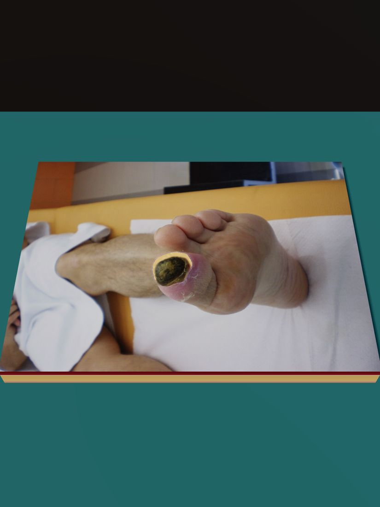
*Contoh foto lanskap: blok berlapis dengan tepi epidermis, dermis, lemak, otot*

## 9. Pemeriksaan sebelum memakai ulang

1. `npx tsc --noEmit` dan `npx vite build` tanpa error.
2. Lihat hasil dengan mata: pasang `preserveDrawingBuffer` sebelum WebGL dibuat, lalu kirim `canvas.toDataURL()` ke berkas dan baca PNG-nya. Panel browser terpotong dan melambat saat tidak di depan; panggil `tabs_select` dan `skipIntro`.
3. Uji reduced-motion, layar sentuh, dan lebar HP (tidak boleh ada gulir horizontal).
4. Tidak ada error konsol; resolusi adaptif bekerja di mesin lemah.
5. Setelah mengubah, bangun ulang image Docker agar server menyajikan versi yang sama dengan GitHub.

